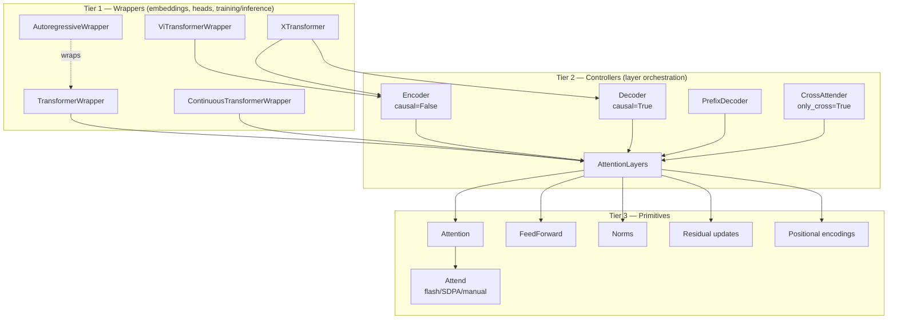
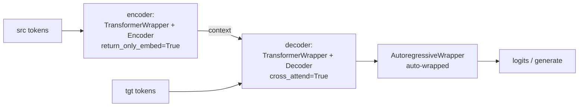

# Architecture Overview

`x-transformers` is a research-oriented, full-attention Transformer toolkit. Its
design philosophy is **one configurable core + thin wrappers**: a single
`AttentionLayers` stack implements every encoder/decoder variant, and wrappers
add embeddings, heads, and training/inference behavior on top.

> Line references use `file:line` against the package as of branch
> `claude/reannotate-and-docs` (2026-06). The core file `x_transformers.py` is
> ~4400 lines; this doc is the map, `core_components.md` is the parts list, and
> `model_inference_flow.md` is the runtime behavior.

## 1. Three-tier hierarchy

- **Tier 1 — Wrappers** handle token/patch/continuous embedding, positional
  embedding, output heads, and training/generation logic.
- **Tier 2 — Controllers**: `AttentionLayers` (`x_transformers.py:2527`) builds
  and runs the per-layer sequence of attention / cross-attention / feedforward
  blocks. `Encoder`/`Decoder`/`PrefixDecoder`/`CrossAttender` are one-line
  subclasses that only fix causality / cross-attention defaults.
- **Tier 3 — Primitives**: `Attention` (`x_transformers.py:1695`) delegates the
  actual score computation to `Attend` (`attend.py:185`); `FeedForward`
  (`x_transformers.py:1609`); plus families of norms, residual updates, and
  positional encodings.

## 2. Controllers: `AttentionLayers` and its subclasses

| Class | Line | What it fixes |
|-------|------|---------------|
| `AttentionLayers` | `2527` | Base. Default block `('a','c','f')`/`('a','f')`; splits `attn_`/`ff_`/`cross_attn_` kwargs; builds `layer_types` + per-layer `[norms, block, residual_fn]`. |
| `Encoder` | `3450` | `causal=False` (asserts caller didn't pass `causal`). |
| `Decoder` | `3455` | `causal=True`. |
| `PrefixDecoder` | `3460` | `causal=False` but overrides `forward` to build a prefix-LM mask (bidirectional over a prefix region, causal after). Only subclass overriding `forward`. |
| `CrossAttender` | `3490` | `cross_attend=True, only_cross=True`. |
| `TransformerBlock` | `3629` | Single-block (`depth=1`) AttentionLayers, no final norm. Exported but omitted from the `__init__` docstring. |

## 3. Wrappers (Tier 1)

| Wrapper | Line | Wraps | Purpose |
|---------|------|-------|---------|
| `TransformerWrapper` | `3645` | any `AttentionLayers` | token-LM: token+pos emb, memory tokens, output head(s), recycling/looped-LM options. |
| `ViTransformerWrapper` | `3548` | `Encoder` | vision: patch embedding + register tokens + abs pos emb. |
| `XTransformer` | `4351` | `Encoder` + `Decoder` | full seq2seq (see §4). |
| `AttentionPool` | `3494` | `CrossAttender`/`Attention` | attention pooling over learned query tokens. |
| `AutoregressiveWrapper` | `autoregressive_wrapper.py:414` | a token-LM net | next-token training + `generate` (sampling, KV cache, contrastive decoding, beam search). |

## 4. `XTransformer` composition (seq2seq)

`XTransformer.__init__` (`x_transformers.py:4351`) splits `enc_`/`dec_` kwargs and
builds:

- Encoder: `TransformerWrapper(..., return_only_embed=True, attn_layers=Encoder)` (`4380`).
- Decoder: `TransformerWrapper(..., attn_layers=Decoder(cross_attend=True))` (`4386`),
  then **auto-wrapped in `AutoregressiveWrapper`** (`4394`) so callers get
  generation for free.
- Optional token-embedding weight tie (`4391`); training-time
  `cross_attn_tokens_dropout` (`4408`).

## 5. Module map (`x_transformers/*.py`)

| Module | Public class(es) | Responsibility |
|--------|------------------|----------------|
| `x_transformers.py` | `AttentionLayers`, `Encoder`, `Decoder`, `PrefixDecoder`, `CrossAttender`, `AttentionPool`, `ViTransformerWrapper`, `TransformerBlock`, `TransformerWrapper`, `XTransformer`, `Attention`, `FeedForward`, norms | The core. |
| `attend.py` | `Attend`, `Intermediates` | Low-level attention executor: flash / SDPA / manual, masking, intermediates. |
| `autoregressive_wrapper.py` | `AutoregressiveWrapper` | Next-token training + generation. |
| `xl_autoregressive_wrapper.py` | `XLAutoregressiveWrapper` | Transformer-XL chunked AR with cross-segment memory. |
| `nonautoregressive_wrapper.py` | `NonAutoregressiveWrapper`, `SelfCritic` | MaskGIT-style parallel iterative demasking. |
| `belief_state_wrapper.py` | `BeliefStateWrapper` | Belief State Transformer: forward+backward decoders ([arXiv 2410.23506]). |
| `continuous.py` | `ContinuousTransformerWrapper`, `ContinuousAutoregressiveWrapper`, `GaussianNLL` | Transformer over continuous (non-tokenized) inputs, Gaussian head. |
| `continuous_autoencoder.py` | `ContinuousTransformerAutoencoder`, `VariationalLatentBottleneck`, `DeterministicLatentBottleneck` | Continuous autoencoder with latent bottleneck (compressed state for RL fine-tuning). |
| `multi_input.py` | `MultiInputTransformerWrapper` | Multiple input modalities/embeddings. |
| `xval.py` | `XValTransformerWrapper`, `XValAutoregressiveWrapper` | XVal continuous-number encoding ([arXiv 2310.02989]). |
| `neo_mlp.py` | `NeoMLP`, `RandomFourierEmbed` | MLP-as-self-attention message passing. |
| `gpt_vae.py` | `GPTVAE` | GPT-style conditional VAE (CVAE + DETR-style query). |
| `free_transformer.py` | `FreeTransformer`, `BinaryMapper` | Encoder → discrete binary latent → two-stage decoder ([arXiv 2510.17558]). |
| `dpo.py` | `DPO` | Direct Preference Optimization with frozen reference ([arXiv 2305.18290]). |
| `entropy_based_tokenizer.py` | `EntropyBasedTokenizer` | Entropy-based dynamic segmentation/tokenization. |

## 6. Exported vs standalone

`__init__.py` exports 26 symbols from 9 modules. **Standalone** modules (NOT in
`__init__.py`, used only via their `train_*.py` script or tests):

- `gpt_vae.py` → `train_gpt_vae.py`
- `free_transformer.py` → `train_free.py`
- `continuous_autoencoder.py` → (test/internal only)
- `up_wrapper.py` (`UniversalPretrainWrapper`, synthetic-data universal
  pretraining, [arXiv 2506.20057]) → (test/internal only)

> Note: `BeliefStateWrapper` *is* exported (`__init__.py:70`) and used by
> `train_belief_state.py` — it is not standalone.

## 7. Train scripts → modules

| Script | Exercises |
|--------|-----------|
| `train_enwik8.py`, `train_length_extrapolate.py`, `train_with_muon.py`, `train_self_masked_repr.py` | `TransformerWrapper` + `Decoder` via `AutoregressiveWrapper` |
| `train_copy.py` | `XTransformer` (enc-dec) |
| `train_parity.py` | `TransformerWrapper` + `Decoder` (no AR wrapper) |
| `train_entropy_tokenizer.py` | `EntropyBasedTokenizer` + AR decoder LM |
| `train_belief_state.py` | `BeliefStateWrapper` |
| `train_gpt_vae.py` | `GPTVAE` |
| `train_free.py` | `FreeTransformer` |

## 8. Known quirks (for readers/maintainers)

- `up_wrapper.py` imports `AutoregressiveWrapper` from `x_transformers.x_transformers`
  (re-exported there at `:24`), not from its canonical home — fragile but valid.
- `PrefixDecoder`'s assert message is copy-pasted from `Decoder` ("cannot set
  causality on decoder") though it is the non-causal/prefix variant — cosmetic.
- `TransformerBlock` is exported but absent from the `__init__` docstring list.

[arXiv 2410.23506]: https://arxiv.org/abs/2410.23506
[arXiv 2310.02989]: https://arxiv.org/abs/2310.02989
[arXiv 2510.17558]: https://arxiv.org/abs/2510.17558
[arXiv 2305.18290]: https://arxiv.org/abs/2305.18290
[arXiv 2506.20057]: https://arxiv.org/abs/2506.20057
