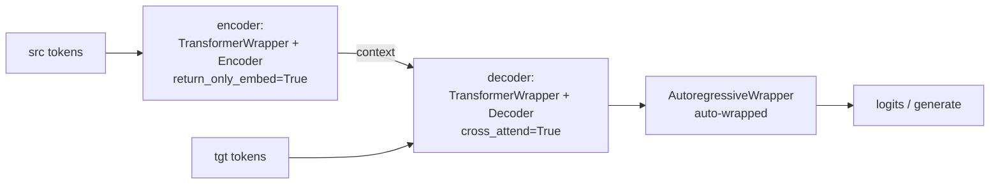

# Architecture Overview

`x-transformers` is a research-oriented, full-attention Transformer toolkit. Its
design philosophy is **one configurable core + thin wrappers**: a single
`AttentionLayers` stack implements every encoder/decoder variant, and wrappers
add embeddings, heads, and training/inference behavior on top.

> Code anchors are written `<module>::<Symbol.path>` — a Python dotted path
> (`Class`, `Class.method`, or a module-level function), never a line number.
> Resolve one with `rg -n 'class Symbol|def Symbol' x_transformers/<module>.py`
> or with ctags. Because nothing here is positional, the anchors survive
> re-annotation and upstream merges. This doc tracks upstream **v2.24.0**; it is
> the map, `core_components.md` is the parts list, and `model_inference_flow.md`
> is the runtime behavior.
>
> Module abbreviations: `xt` = `x_transformers.py` (the core, ~4.7k lines),
> `attend` = `attend.py`, `arw` = `autoregressive_wrapper.py`,
> `xl` = `xl_autoregressive_wrapper.py`, `nar` = `nonautoregressive_wrapper.py`,
> `bsw` = `belief_state_wrapper.py`, `cont` = `continuous.py`,
> `cae` = `continuous_autoencoder.py`, `ebt` = `entropy_based_tokenizer.py`,
> `ft` = `free_transformer.py`, `lejepa` = `gpt_lejepa.py`, `vae` = `gpt_vae.py`,
> `mi` = `multi_input.py`, `nmlp` = `neo_mlp.py`, `nlw` = `next_latent_wrapper.py`,
> `up` = `up_wrapper.py`, `xval` = `xval.py`, `dpo` = `dpo.py`.

## 1. Three-tier hierarchy

```mermaid
graph TD
    subgraph Wrappers["Tier 1 — Wrappers (embeddings, heads, training/inference)"]
        TW[TransformerWrapper]
        ViT[ViTransformerWrapper]
        XT[XTransformer]
        CTW[ContinuousTransformerWrapper]
        AR[AutoregressiveWrapper]
        XLAR[XLAutoregressiveWrapper<br/>segment mems + e2e TTT]
        NLW[NextLatentWrapper<br/>training only]
        LEJ[LatentAutoregressive<br/>training only]
    end
    subgraph Controllers["Tier 2 — Controllers (layer orchestration)"]
        AL[AttentionLayers]
        ENC[Encoder<br/>causal=False]
        DEC[Decoder<br/>causal=True]
        PRE[PrefixDecoder]
        CA[CrossAttender<br/>only_cross=True]
    end
    subgraph Primitives["Tier 3 — Primitives"]
        ATTN[Attention]
        ATTEND[Attend<br/>flash/SDPA/manual]
        FF[FeedForward]
        NORM[Norms]
        RES[Residual updates]
        PE[Positional encodings]
    end

    TW --> AL
    ViT --> ENC
    XT --> ENC
    XT --> DEC
    CTW --> AL
    AR -. wraps .-> TW
    XLAR -. wraps .-> TW
    NLW -. wraps .-> TW
    LEJ -. wraps .-> TW
    NLW -. unwrap .net at inference .-> AR
    ENC --> AL
    DEC --> AL
    PRE --> AL
    CA --> AL
    AL --> ATTN
    AL --> FF
    AL --> NORM
    AL --> RES
    AL --> PE
    ATTN --> ATTEND
```

- **Tier 1 — Wrappers** handle token/patch/continuous embedding, positional
  embedding, output heads, and training/generation logic. Two of them
  (`nlw::NextLatentWrapper`, `lejepa::LatentAutoregressive`) are training-only
  and expose no `generate` — see §9.
- **Tier 2 — Controllers**: `xt::AttentionLayers` builds and runs the per-layer
  sequence of attention / cross-attention / feedforward blocks in
  `xt::AttentionLayers.forward`. `Encoder`/`Decoder`/`PrefixDecoder`/`CrossAttender`
  are one-line subclasses that only fix causality / cross-attention defaults.
- **Tier 3 — Primitives**: `xt::Attention` delegates the actual score computation
  to `attend::Attend`; `xt::FeedForward`; plus families of norms, residual
  updates, and positional encodings — including the new
  `xt::RelativeProjPositionalBias` (§9.4).

## 2. Controllers: `AttentionLayers` and its subclasses

| Class | Anchor | What it fixes |
|-------|--------|---------------|
| `AttentionLayers` | `xt::AttentionLayers` | Base. Default block `('a','c','f')`/`('a','f')`; splits `attn_`/`ff_`/`cross_attn_` kwargs; builds `layer_types` + per-layer `[norms, block, residual_fn]`. |
| `Encoder` | `xt::Encoder` | `causal=False` (asserts caller didn't pass `causal`). |
| `Decoder` | `xt::Decoder` | `causal=True`. |
| `PrefixDecoder` | `xt::PrefixDecoder` | `causal=False` but overrides `xt::PrefixDecoder.forward` to build a prefix-LM mask (bidirectional over a prefix region, causal after). Only subclass overriding `forward`. |
| `CrossAttender` | `xt::CrossAttender` | `cross_attend=True, only_cross=True`. |
| `TransformerBlock` | `xt::TransformerBlock` | Single-block (`depth=1`) AttentionLayers, no final norm. Exported but omitted from the `__init__` docstring. |

Any `attn_*` / `ff_*` kwarg that `AttentionLayers` forwards per layer also accepts
a tuple of per-layer values. `xt::layer_schedule` builds such a tuple by
interpolating one hyperparameter from `start` to `end` across `depth` — see §9.4.

## 3. Wrappers (Tier 1)

| Wrapper | Anchor | Wraps | Purpose |
|---------|--------|-------|---------|
| `TransformerWrapper` | `xt::TransformerWrapper` | any `AttentionLayers` | token-LM: token+pos emb, memory tokens, output head(s), recycling/looped-LM options. |
| `ViTransformerWrapper` | `xt::ViTransformerWrapper` | `Encoder` | vision: patch embedding + register tokens + abs pos emb. |
| `XTransformer` | `xt::XTransformer` | `Encoder` + `Decoder` | full seq2seq (see §4). |
| `AttentionPool` | `xt::AttentionPool` | `CrossAttender`/`Attention` | attention pooling over learned query tokens. |
| `AutoregressiveWrapper` | `arw::AutoregressiveWrapper` | a token-LM net | next-token training + `arw::AutoregressiveWrapper.generate` (sampling, KV cache, contrastive decoding, beam search). |
| `XLAutoregressiveWrapper` | `xl::XLAutoregressiveWrapper` | a token-LM net | Transformer-XL segment memory + optional end-to-end test-time training (§9.3). |
| `NextLatentWrapper` | `nlw::NextLatentWrapper` | a token-LM net | **training only** — adds a next-latent rollout objective (§9.2). |
| `LatentAutoregressive` | `lejepa::LatentAutoregressive` | a token-LM net | **training only** — LeJEPA-style latent objective (§9.1). |

## 4. `XTransformer` composition (seq2seq)

`xt::XTransformer.__init__` splits `enc_`/`dec_` kwargs and builds:



- Encoder: `TransformerWrapper(..., return_only_embed = True, attn_layers = Encoder(...))`.
- Decoder: `TransformerWrapper(..., attn_layers = Decoder(cross_attend = True, ...))`,
  then **auto-wrapped in `arw::AutoregressiveWrapper`** so callers get generation
  for free — hence `xt::XTransformer.generate` is a two-liner.
- Optional token-embedding weight tie (`tie_token_emb`); training-time
  `cross_attn_tokens_dropout` applied in `xt::XTransformer.forward`.

## 5. Module map (`x_transformers/*.py`)

| Module | Public class(es) | Responsibility |
|--------|------------------|----------------|
| `x_transformers.py` | `xt::AttentionLayers`, `xt::Encoder`, `xt::Decoder`, `xt::PrefixDecoder`, `xt::CrossAttender`, `xt::AttentionPool`, `xt::ViTransformerWrapper`, `xt::TransformerBlock`, `xt::TransformerWrapper`, `xt::XTransformer`, `xt::Attention`, `xt::FeedForward`, `xt::layer_schedule`, norms | The core. |
| `attend.py` | `attend::Attend`, `attend::Intermediates` | Low-level attention executor: flash / SDPA / manual, masking, intermediates. |
| `autoregressive_wrapper.py` | `arw::AutoregressiveWrapper` | Next-token training + generation. |
| `xl_autoregressive_wrapper.py` | `xl::XLAutoregressiveWrapper`, `xl::TTTModuleWrapper`, `xl::TTTMetaLearningTargetKLLoss`, `xl::EpisodicMemoryWrapper` | Transformer-XL chunked AR with cross-segment memory, plus end-to-end test-time training ([arXiv 2512.23675]). |
| `nonautoregressive_wrapper.py` | `nar::NonAutoregressiveWrapper`, `nar::SelfCritic` | MaskGIT-style parallel iterative demasking. |
| `belief_state_wrapper.py` | `bsw::BeliefStateWrapper` | Belief State Transformer: forward+backward decoders ([arXiv 2410.23506]). |
| `next_latent_wrapper.py` | `nlw::NextLatentWrapper`, `nlw::ResidualDynamics`, `nlw::RolloutGRU`, `nlw::MSECosineSimLoss` | Next-latent prediction: action-conditioned rollout in representation space ([arXiv 2511.05963]). |
| `gpt_lejepa.py` | `lejepa::LatentAutoregressive` | LeJEPA-style objective — latent rollout + SIGReg, CE demoted to a probe ([arXiv 2511.08544], [arXiv 2509.14252v2]). |
| `continuous.py` | `cont::ContinuousTransformerWrapper`, `cont::ContinuousAutoregressiveWrapper`, `cont::GaussianNLL` | Transformer over continuous (non-tokenized) inputs, Gaussian head. |
| `continuous_autoencoder.py` | `cae::ContinuousTransformerAutoencoder`, `cae::VariationalLatentBottleneck`, `cae::DeterministicLatentBottleneck` | Continuous autoencoder with latent bottleneck (compressed state for RL fine-tuning). |
| `multi_input.py` | `mi::MultiInputTransformerWrapper` | Multiple input modalities/embeddings. |
| `xval.py` | `xval::XValTransformerWrapper`, `xval::XValAutoregressiveWrapper` | XVal continuous-number encoding ([arXiv 2310.02989]). |
| `neo_mlp.py` | `nmlp::NeoMLP`, `nmlp::RandomFourierEmbed` | MLP-as-self-attention message passing. |
| `gpt_vae.py` | `vae::GPTVAE` | GPT-style conditional VAE (CVAE + DETR-style query). |
| `free_transformer.py` | `ft::FreeTransformer`, `ft::BinaryMapper` | Encoder → discrete binary latent → two-stage decoder ([arXiv 2510.17558]). |
| `up_wrapper.py` | `up::UniversalPretrainWrapper`, `up::SyntheticDataGenerator` | Synthetic-data universal pretraining ([arXiv 2506.20057]). |
| `dpo.py` | `dpo::DPO` | Direct Preference Optimization with frozen reference ([arXiv 2305.18290]). |
| `entropy_based_tokenizer.py` | `ebt::EntropyBasedTokenizer`, `ebt::get_accumulated_threshold_mask` | Entropy-based dynamic segmentation/tokenization. |

## 6. Exported vs standalone

The rule: `__init__.py` re-exports the pieces you are expected to assemble models
out of. Everything else is a self-contained experiment, imported from its own
module path and driven by a `train_*.py` script or by tests.

**Standalone** (NOT re-exported):

| Module | Entry point | Driver |
|--------|-------------|--------|
| `gpt_vae.py` | `vae::GPTVAE` | `train_gpt_vae.py` |
| `free_transformer.py` | `ft::FreeTransformer` | `train_free.py` |
| `gpt_lejepa.py` | `lejepa::LatentAutoregressive` | `train_enwik8_lejepa_style.py` |
| `continuous_autoencoder.py` | `cae::ContinuousTransformerAutoencoder` | tests only |
| `up_wrapper.py` | `up::UniversalPretrainWrapper` | tests only — **no train script exists** |

Everything else in `x_transformers/` is re-exported. At v2.24.0 that works out to
27 symbols drawn from 12 modules, but read the count off the import block rather
than trusting this sentence — it moves every release.

> Two things that look like exceptions and are not. `bsw::BeliefStateWrapper` *is*
> exported and is used by `train_belief_state.py`. `nlw::NextLatentWrapper` is
> exported too, even though its own `generate`-less design means you unwrap it
> before sampling.

## 7. Train scripts → modules

All 13 scripts at the repo root:

| Script | Exercises |
|--------|-----------|
| `train_belief_state.py` | `xt::TransformerWrapper` + `xt::Decoder` + `bsw::BeliefStateWrapper` + `arw::AutoregressiveWrapper` |
| `train_copy.py` | `xt::XTransformer` (enc-dec) |
| `train_entropy_tokenizer.py` | `xt::TransformerWrapper` + `xt::Decoder` + `arw::AutoregressiveWrapper` + `ebt::EntropyBasedTokenizer` |
| `train_enwik8.py` | `xt::TransformerWrapper` + `xt::Decoder` + `arw::AutoregressiveWrapper` |
| `train_enwik8_lejepa_style.py` | `xt::TransformerWrapper` + `xt::Decoder` + `arw::AutoregressiveWrapper` + `lejepa::LatentAutoregressive` |
| `train_free.py` | `ft::FreeTransformer` |
| `train_gpt_vae.py` | `vae::GPTVAE` |
| `train_length_extrapolate.py` | `xt::TransformerWrapper` + `xt::Decoder` + `arw::AutoregressiveWrapper` |
| `train_parity.py` | `xt::TransformerWrapper` + `xt::Decoder` (no AR wrapper) |
| `train_path_star.py` | `xt::TransformerWrapper` + `xt::Decoder` + `arw::AutoregressiveWrapper` + `xt::RMSNorm` + `nlw::NextLatentWrapper` |
| `train_self_masked_repr.py` | `xt::TransformerWrapper` + `xt::Decoder` + `arw::AutoregressiveWrapper` + `xt::RMSNorm` + `xt::FeedForward` (+ `MLP` from `x_mlps_pytorch`) |
| `train_with_muon.py` | `xt::TransformerWrapper` + `xt::Decoder` + `arw::AutoregressiveWrapper` (+ `MuonAdamAtan2` from `adam_atan2_pytorch`) |
| `train_xl_enwik8.py` | `xt::TransformerWrapper` + `xt::Decoder` + `xl::XLAutoregressiveWrapper` + `xl::TTTMetaLearningTargetKLLoss` |

`up_wrapper.py` is the one module with a public entry point and **no train
script** — its only driver is the test suite.

## 8. Known quirks (for readers/maintainers)

- `up_wrapper.py` imports `AutoregressiveWrapper` from `x_transformers.x_transformers`
  (where it is only a re-export, `xt` importing it from `arw` for `XTransformer`'s
  own use), not from its canonical home — fragile but valid.
- `xt::PrefixDecoder`'s assert message is copy-pasted from `xt::Decoder` ("cannot
  set causality on decoder") though it is the non-causal/prefix variant — cosmetic.
- The `__init__.py` docstring lists 26 of the 27 exported symbols;
  `xt::TransformerBlock` is exported but absent from that list.
- `xl::TTTModuleWrapper` shifts checkpoint keys by one level (`...to_v.weight`
  becomes `...to_v.module.weight`) for every path named in `ttt_module_paths`.

## 9. New in upstream v2.24.0

### 9.1 `lejepa::LatentAutoregressive` — LeJEPA-style objective

Wraps a `xt::TransformerWrapper` + `xt::Decoder`. A predictor MLP maps the hidden
state at position `i`, concatenated with an action embedding (the embedding of the
teacher-forced token id consumed at that step), to the net's **own output
embedding** at `i + 1` — that is the hidden returned under `return_embeddings =
True`, the tensor feeding `to_logits`, not a lookup in the token embedding table.
That is unrolled `num_rollouts` steps entirely in latent space: the predictor
consumes its own output and the transformer runs exactly once per forward.

The predictor's *input* need not be the same tensor it is chasing:
`predictor_input_hiddens_index` (default `-1`) reads
`cache.hiddens[...]`, the residual stream entering the final attention block, so
the predictor sits one block below its target. The action embedding comes from the
wrapper's own `nn.Embedding`, not the net's table.

| Piece | Behavior |
|-------|----------|
| `lejepa::scale_grad` | `t * scale + t.detach() * (1 - scale)` — identity forward, gradient multiplied by `scale` backward. `scale = 0.` is a plain stop-gradient. |
| `frac_gradient` | Fraction of the CE probe's gradient that reaches the trunk. Default `0.`, so cross-entropy survives only as a probe and trains the probe alone. |
| `lejepa::LatentAutoregressive.sigreg_loss` | SIGReg. Projects embeddings onto random unit slices, compares each slice's empirical characteristic function against `exp(-t^2/2)` — the N(0,1) characteristic function, which doubles as the integration weight — trapezoid-integrates over `t`, then means over slices. This is what stops the latent loss being solved by a constant embedding. |
| `predict_next_cosine_sim` | L2-normalizes predictions and targets, which makes the MSE equal `2 - 2cos` since both sides are unit-norm. |
| `detach_target` | The JEPA target-branch stop-gradient. |

Loss breakdown order is `(ce, l2, l2_no_action, sigreg)`. Cited in the module
header: [arXiv 2511.08544] (Balestriero & LeCun) and [arXiv 2509.14252v2]
(Hai Huang). Runnable example: `train_enwik8_lejepa_style.py`.

### 9.2 `nlw::NextLatentWrapper` — next-latent prediction

**Training-only wrapper: it has no `generate` method.** At inference you take
`.net` — the identical object you passed in, not a copy — and hand it to
`arw::AutoregressiveWrapper`. This is the single most important usage fact about
the module; `train_path_star.py` does exactly `AutoregressiveWrapper(unwrapped_model.net)`.

The wrapper predicts the next *latent* rather than the next token, unrolled
`num_rollouts` steps.

| Piece | Behavior |
|-------|----------|
| Gradient routing | Rollout targets and action embeddings are detached; the starting latent is **not**, so that is the only path by which the rollout losses reach the transformer. |
| KL term | Decodes predicted and true latents through a frozen copy of `to_logits`. That copy is a per-forward `deepcopy`, **not** an EMA target network. |
| Dynamic rollout weighting | `sigmoid(-decay * (exclusive_cumsum(step_loss) - threshold))`, fully detached — a curriculum on unroll depth, so step `r` is discounted by how badly steps `< r` are currently doing. |
| `nlw::ResidualDynamics` | Default transition model: `latent <- latent + net(cat(latent, action))`. The default net's last `Linear` is zero-init'd, so the transition starts as the identity. |
| `nlw::RolloutGRU` | Alternative transition model; documented upstream as the weaker ablation. |
| `nlw::MSECosineSimLoss` | Blends per-element MSE and per-vector cosine distance. Selected by `loss_type = 'mse_and_cosine_sim'`, whose branch carries the in-source comment `# https://arxiv.org/abs/2606.30534`. |

Scheme cited in the module header: [arXiv 2511.05963]. Runnable example:
`train_path_star.py`.

### 9.3 End-to-end test-time training in `xl_autoregressive_wrapper.py`

The file grew 323 → 1037 lines. Submodules named by dotted path in
`ttt_module_paths` are wrapped in-place by `xl::TTTModuleWrapper`.

| Piece | Behavior |
|-------|----------|
| Fast weights | Each `xl::TTTModuleWrapper` holds per-batch-element weights of shape `(batch, *param_shape)` as a **plain attribute, not registered parameters**, so they stay out of `state_dict()`. The submodule is then run through `torch.func.functional_call` under `vmap`, so each sample uses its own weight slice. |
| `xl::XLAutoregressiveWrapper.init_ttt` | Re-seeds fast weights from the slow weights at the start of every `forward`/`generate` via a differentiable broadcast. TTT state never persists across calls, yet outer gradients still reach the underlying `nn.Parameter`s. |
| `xl::XLAutoregressiveWrapper.update_ttt` | Differentiates the segment loss — cross-entropy by default, or `ttt_custom_loss_module` (e.g. `xl::TTTMetaLearningTargetKLLoss`, which reads `intermediates.last_layer_hiddens` instead of logits) — optionally orthogonalizes each gradient with a 5-step Newton-Schulz iteration (`xl::newtonschulz5`, the Muon path, which applies only to per-sample matrices and then uses `ttt_muon_lr`), and applies `p <- p - lr*g - lr*wd*p`. |
| Source/target decoupling | `ttt_module_paths` entries may be `(source_path, target_path)` pairs, so a gradient computed at one layer can update another. Updates accumulate across segments. |
| Second-order term | In `xl::XLAutoregressiveWrapper.forward` the inner step uses `create_graph = self.training`, leaving the updated fast weight a non-leaf whose history runs back into the slow weights — so the outer backward carries **second-order** terms. `xl::XLAutoregressiveWrapper.generate` always passes `create_graph = False` and detaches/re-leafs instead. |
| Truncation cadence | Composes with Transformer-XL segment memory on a single `tbptt_steps` cadence: every `tbptt_steps`-th segment sets `detach_mems = True` **and** re-leafs the fast weights, truncating both recurrences together. `tbptt_steps > 1` is asserted when TTT is on. |
| `xl::EpisodicMemories` / `xl::EpisodicMemoryWrapper` | Also new here: a learned per-layer kv bank prepended to every self-attention layer's keys/values, usable as a dedicated long-term TTT target via `ttt_module_paths = ('episodic_mems',)`. |

Cited in README: [arXiv 2512.23675]. Runnable example: `train_xl_enwik8.py`.

### 9.4 Smaller additions

| Addition | Behavior |
|----------|----------|
| `xt::RelativeProjPositionalBias` | New positional bias (from Thinking Machines' Inkling). Each token projects, per head, its own mixture over a shared bank of distance basis curves, so the bias-versus-distance profile is content-dependent rather than a fixed per-head slope. Flags: `use_rel_proj_pos_bias`, `rel_proj_num_distance_basis`, `rel_proj_max_dist`. **No paper is cited in source.** |
| `xt::layer_schedule` | New export. Returns a depth-length tuple interpolating one hyperparameter from `start` to `end` (`'linear'` / `'cosine'` / any callable). Used for per-layer `ff_mult`, `attn_dropout`, `ff_dropout`. |
| Inverted (cross) attention | `attend::Attend`'s `inverted_attention` flag normalizes across queries instead of keys; the query-side padding mask then has to arrive separately as `row_mask`. Incompatible with flash. |
| `ebt::get_accumulated_threshold_mask` | Entropy-*accumulation* segmentation: cuts where the running entropy sum since the last boundary reaches `threshold`, so segment length adapts inversely to surprise density. An alternative to the BLT global-threshold rule, which tests each position independently. |

[arXiv 2410.23506]: https://arxiv.org/abs/2410.23506
[arXiv 2310.02989]: https://arxiv.org/abs/2310.02989
[arXiv 2510.17558]: https://arxiv.org/abs/2510.17558
[arXiv 2305.18290]: https://arxiv.org/abs/2305.18290
[arXiv 2506.20057]: https://arxiv.org/abs/2506.20057
[arXiv 2511.08544]: https://arxiv.org/abs/2511.08544
[arXiv 2509.14252v2]: https://arxiv.org/abs/2509.14252v2
[arXiv 2511.05963]: https://arxiv.org/abs/2511.05963
[arXiv 2512.23675]: https://arxiv.org/abs/2512.23675
