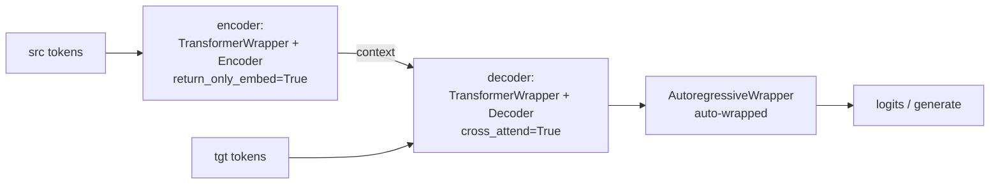

# Architecture Overview

`x-transformers` is a research-oriented, full-attention Transformer toolkit. Its
design philosophy is **one configurable core + thin wrappers**: a single
`AttentionLayers` stack implements every encoder/decoder variant, and wrappers
add embeddings, heads, and training/inference behavior on top.

> Code anchors are written `<module>::<Symbol.path>` — a Python dotted path
> (`Class`, `Class.method`, or a module-level function), never a line number.
> Resolve one with `rg -n 'class Symbol|def Symbol' x_transformers/<module>.py`
> or with ctags. Because nothing here is positional, the anchors survive
> re-annotation and upstream merges. `scripts/check_doc_symbols.py` verifies
> that every one of them still resolves. This doc tracks upstream **v2.31.1**; it is
> the map, `core_components.md` is the parts list, and `model_inference_flow.md`
> is the runtime behavior.
>
> Module abbreviations: `xt` = `x_transformers.py` (the core, ~5.1k lines),
> `attend` = `attend.py`, `arw` = `autoregressive_wrapper.py`,
> `xl` = `xl_autoregressive_wrapper.py`, `nar` = `nonautoregressive_wrapper.py`,
> `bsw` = `belief_state_wrapper.py`, `cont` = `continuous.py`,
> `cae` = `continuous_autoencoder.py`, `ebt` = `entropy_based_tokenizer.py`,
> `ft` = `free_transformer.py`, `lejepa` = `gpt_lejepa.py`, `vae` = `gpt_vae.py`,
> `mi` = `multi_input.py`, `nmlp` = `neo_mlp.py`, `nlw` = `next_latent_wrapper.py`,
> `up` = `up_wrapper.py`, `xval` = `xval.py`, `dpo` = `dpo.py`,
> `fb` = `full_bandwidth.py`, `recirc` = `recirculation.py`,
> `xm` = `xm_latent_decoder.py`, `disc` = `discover_wrapper.py`.

## 1. Three-tier hierarchy

```mermaid
graph TD
    subgraph Wrappers["Tier 1 — Wrappers (embeddings, heads, training/inference)"]
        TW[TransformerWrapper]
        ViT[ViTransformerWrapper]
        XT[XTransformer]
        CTW[ContinuousTransformerWrapper]
        AR[AutoregressiveWrapper]
        XLAR[XLAutoregressiveWrapper<br/>segment mems + e2e TTT]
        NLW[NextLatentWrapper<br/>training only]
        LEJ[LatentAutoregressive<br/>training only]
        FB[FullBandwidth<br/>temporal passes]
        REC[Recirculation]
        XM[XMLatentDecoder]
        DISC[DiscoverDecoder]
    end
    subgraph Controllers["Tier 2 — Controllers (layer orchestration)"]
        AL[AttentionLayers]
        ENC[Encoder<br/>causal=False]
        DEC[Decoder<br/>causal=True]
        PRE[PrefixDecoder]
        CA[CrossAttender<br/>only_cross=True]
    end
    subgraph Primitives["Tier 3 — Primitives"]
        ATTN[Attention]
        ATTEND[Attend<br/>flash/SDPA/manual]
        FF[FeedForward]
        NORM[Norms]
        RES[Residual updates]
        PE[Positional encodings]
    end

    TW --> AL
    ViT --> ENC
    XT --> ENC
    XT --> DEC
    CTW --> AL
    AR -. wraps .-> TW
    XLAR -. wraps .-> TW
    NLW -. wraps .-> TW
    LEJ -. wraps .-> TW
    FB -. wraps .-> TW
    REC -. wraps .-> TW
    XM -. wraps .-> TW
    DISC -. wraps .-> TW
    NLW -. unwrap .net at inference .-> AR
    ENC --> AL
    DEC --> AL
    PRE --> AL
    CA --> AL
    AL --> ATTN
    AL --> FF
    AL --> NORM
    AL --> RES
    AL --> PE
    ATTN --> ATTEND
```

- **Tier 1 — Wrappers** handle token/patch/continuous embedding, positional
  embedding, output heads, and training/generation logic. Two of them
  (`nlw::NextLatentWrapper`, `lejepa::LatentAutoregressive`) are training-only
  and expose no `generate` — see §9. The four v2.31.1 additions are covered in §10.
- **Tier 2 — Controllers**: `xt::AttentionLayers` builds and runs the per-layer
  sequence of attention / cross-attention / feedforward blocks in
  `xt::AttentionLayers.forward`. `Encoder`/`Decoder`/`PrefixDecoder`/`CrossAttender`
  are one-line subclasses that only fix causality / cross-attention defaults.
- **Tier 3 — Primitives**: `xt::Attention` delegates the actual score computation
  to `attend::Attend`; `xt::FeedForward`; plus families of norms, residual
  updates, and positional encodings — including `xt::RelativeProjPositionalBias`
  (§9.4) and the v2.31.1 residual / gating changes (§10.5).

## 2. Controllers: `AttentionLayers` and its subclasses

| Class | Anchor | What it fixes |
|-------|--------|---------------|
| `AttentionLayers` | `xt::AttentionLayers` | Base. Default block `('a','c','f')`/`('a','f')`; splits `attn_`/`ff_`/`cross_attn_` kwargs; builds `layer_types` + per-layer `[norms, block, residual_fn]`. |
| `Encoder` | `xt::Encoder` | `causal=False` (asserts caller didn't pass `causal`). |
| `Decoder` | `xt::Decoder` | `causal=True`. |
| `PrefixDecoder` | `xt::PrefixDecoder` | `causal=False` but overrides `xt::PrefixDecoder.forward` to build a prefix-LM mask (bidirectional over a prefix region, causal after). Only subclass overriding `forward`. |
| `CrossAttender` | `xt::CrossAttender` | `cross_attend=True, only_cross=True`. |
| (any) | `xt::AttentionLayers` | `only_attn=True` drops every `'f'` from the layer schedule, giving an attention-only stack (v2.31.1). |
| `TransformerBlock` | `xt::TransformerBlock` | Single-block (`depth=1`) AttentionLayers, no final norm. Exported but omitted from the `__init__` docstring. |

Any `attn_*` / `ff_*` kwarg that `AttentionLayers` forwards per layer also accepts
a tuple of per-layer values. `xt::layer_schedule` builds such a tuple by
interpolating one hyperparameter from `start` to `end` across `depth` — see §9.4.

## 3. Wrappers (Tier 1)

| Wrapper | Anchor | Wraps | Purpose |
|---------|--------|-------|---------|
| `TransformerWrapper` | `xt::TransformerWrapper` | any `AttentionLayers` | token-LM: token+pos emb, memory tokens, output head(s), recycling/looped-LM options. |
| `ViTransformerWrapper` | `xt::ViTransformerWrapper` | `Encoder` | vision: patch embedding + register tokens + abs pos emb. |
| `XTransformer` | `xt::XTransformer` | `Encoder` + `Decoder` | full seq2seq (see §4). |
| `AttentionPool` | `xt::AttentionPool` | `CrossAttender`/`Attention` | attention pooling over learned query tokens. |
| `AutoregressiveWrapper` | `arw::AutoregressiveWrapper` | a token-LM net | next-token training + `arw::AutoregressiveWrapper.generate` (sampling, KV cache, contrastive decoding, beam search). |
| `XLAutoregressiveWrapper` | `xl::XLAutoregressiveWrapper` | a token-LM net | Transformer-XL segment memory + optional end-to-end test-time training (§9.3). |
| `NextLatentWrapper` | `nlw::NextLatentWrapper` | a token-LM net | **training only** — adds a next-latent rollout objective (§9.2). |
| `LatentAutoregressive` | `lejepa::LatentAutoregressive` | a token-LM net | **training only** — LeJEPA-style latent objective (§9.1). |
| `FullBandwidth` | `fb::FullBandwidth` | a token-LM net | full-bandwidth transformer: temporal parallel passes that feed block latents back in (§10.1). |
| `Recirculation` | `recirc::Recirculation` | a token-LM net | recirculation (Mozer et al.) (§10.2). |
| `XMLatentDecoder` | `xm::XMLatentDecoder` | a token-LM net | encoder-free latent variable decoder, explorative modeling (§10.3). |
| `DiscoverDecoder` | `disc::DiscoverDecoder` | a token-LM net | DISCOVER bottleneck decoder + TPR probing and surgery (§10.4). |

## 4. `XTransformer` composition (seq2seq)

`xt::XTransformer.__init__` splits `enc_`/`dec_` kwargs and builds:



- Encoder: `TransformerWrapper(..., return_only_embed = True, attn_layers = Encoder(...))`.
- Decoder: `TransformerWrapper(..., attn_layers = Decoder(cross_attend = True, ...))`,
  then **auto-wrapped in `arw::AutoregressiveWrapper`** so callers get generation
  for free — hence `xt::XTransformer.generate` is a two-liner.
- Optional token-embedding weight tie (`tie_token_emb`); training-time
  `cross_attn_tokens_dropout` applied in `xt::XTransformer.forward`.

## 5. Module map (`x_transformers/*.py`)

| Module | Public class(es) | Responsibility |
|--------|------------------|----------------|
| `x_transformers.py` | `xt::AttentionLayers`, `xt::Encoder`, `xt::Decoder`, `xt::PrefixDecoder`, `xt::CrossAttender`, `xt::AttentionPool`, `xt::ViTransformerWrapper`, `xt::TransformerBlock`, `xt::TransformerWrapper`, `xt::XTransformer`, `xt::Attention`, `xt::FeedForward`, `xt::layer_schedule`, norms | The core. |
| `attend.py` | `attend::Attend`, `attend::Intermediates`, `attend::default_device` | Low-level attention executor: flash / SDPA / manual, masking, intermediates. |
| `autoregressive_wrapper.py` | `arw::AutoregressiveWrapper` | Next-token training + generation. |
| `xl_autoregressive_wrapper.py` | `xl::XLAutoregressiveWrapper`, `xl::TTTModuleWrapper`, `xl::TTTMetaLearningTargetKLLoss`, `xl::EpisodicMemoryWrapper` | Transformer-XL chunked AR with cross-segment memory, plus end-to-end test-time training ([arXiv 2512.23675]). |
| `nonautoregressive_wrapper.py` | `nar::NonAutoregressiveWrapper`, `nar::SelfCritic` | MaskGIT-style parallel iterative demasking. |
| `belief_state_wrapper.py` | `bsw::BeliefStateWrapper` | Belief State Transformer: forward+backward decoders ([arXiv 2410.23506]). |
| `next_latent_wrapper.py` | `nlw::NextLatentWrapper`, `nlw::ResidualDynamics`, `nlw::RolloutGRU`, `nlw::MSECosineSimLoss` | Next-latent prediction: action-conditioned rollout in representation space ([arXiv 2511.05963]). |
| `gpt_lejepa.py` | `lejepa::LatentAutoregressive` | LeJEPA-style objective — latent rollout + SIGReg, CE demoted to a probe ([arXiv 2511.08544], [arXiv 2509.14252v2]). |
| `continuous.py` | `cont::ContinuousTransformerWrapper`, `cont::ContinuousAutoregressiveWrapper`, `cont::GaussianNLL` | Transformer over continuous (non-tokenized) inputs, Gaussian head. |
| `continuous_autoencoder.py` | `cae::ContinuousTransformerAutoencoder`, `cae::VariationalLatentBottleneck`, `cae::DeterministicLatentBottleneck` | Continuous autoencoder with latent bottleneck (compressed state for RL fine-tuning). |
| `multi_input.py` | `mi::MultiInputTransformerWrapper` | Multiple input modalities/embeddings. |
| `xval.py` | `xval::XValTransformerWrapper`, `xval::XValAutoregressiveWrapper` | XVal continuous-number encoding ([arXiv 2310.02989]). |
| `neo_mlp.py` | `nmlp::NeoMLP`, `nmlp::RandomFourierEmbed` | MLP-as-self-attention message passing. |
| `gpt_vae.py` | `vae::GPTVAE` | GPT-style conditional VAE (CVAE + DETR-style query). |
| `free_transformer.py` | `ft::FreeTransformer`, `ft::BinaryMapper` | Encoder → discrete binary latent → two-stage decoder ([arXiv 2510.17558]). |
| `up_wrapper.py` | `up::UniversalPretrainWrapper`, `up::SyntheticDataGenerator` | Synthetic-data universal pretraining ([arXiv 2506.20057]). |
| `dpo.py` | `dpo::DPO` | Direct Preference Optimization with frozen reference ([arXiv 2305.18290]). |
| `entropy_based_tokenizer.py` | `ebt::EntropyBasedTokenizer`, `ebt::get_accumulated_threshold_mask` | Entropy-based dynamic segmentation/tokenization. |
| `full_bandwidth.py` | `fb::FullBandwidth` + transition modules | Full-bandwidth transformer ([arXiv 2608.08888]). |
| `recirculation.py` | `recirc::Recirculation`, `recirc::RecirculationMixer` | Recirculation ([arXiv 2608.17981]). |
| `xm_latent_decoder.py` | `xm::XMLatentDecoder`, `xm::lowest_loss_winner_fn` | Encoder-free latent variable decoder with explorative modeling. |
| `discover_wrapper.py` | `disc::DiscoverDecoder`, `disc::TPREncoder`, `disc::role_ids_for_tokens` | DISCOVER: TPR probing of a bottleneck encoding ([arXiv 2608.29530]). |

## 6. Exported vs standalone

The rule: `__init__.py` re-exports the pieces you are expected to assemble models
out of. Everything else is a self-contained experiment, imported from its own
module path and driven by a `train_*.py` script or by tests.

**Standalone** (NOT re-exported):

| Module | Entry point | Driver |
|--------|-------------|--------|
| `gpt_vae.py` | `vae::GPTVAE` | `train_gpt_vae.py` |
| `free_transformer.py` | `ft::FreeTransformer` | `train_free.py` |
| `gpt_lejepa.py` | `lejepa::LatentAutoregressive` | `train_enwik8_lejepa_style.py` |
| `continuous_autoencoder.py` | `cae::ContinuousTransformerAutoencoder` | tests only |
| `up_wrapper.py` | `up::UniversalPretrainWrapper` | tests only — **no train script exists** |
| `full_bandwidth.py` | `fb::FullBandwidth` | `train_full_bandwidth.py`, `train_full_bandwidth_parity.py` |
| `recirculation.py` | `recirc::Recirculation` | `train_parity_recirculation.py` |
| `xm_latent_decoder.py` | `xm::XMLatentDecoder` | `train_enwik8_xm.py` |
| `discover_wrapper.py` | `disc::DiscoverDecoder`, `disc::TPREncoder` | `train_discover_reversal.py` |

Everything else in `x_transformers/` is re-exported. At v2.31.1 that works out to
28 symbols drawn from 12 modules (v2.24.0 plus `default_device`), but read the
count off the import block rather than trusting this sentence — it moves every
release.

> Two things that look like exceptions and are not. `bsw::BeliefStateWrapper` *is*
> exported and is used by `train_belief_state.py`. `nlw::NextLatentWrapper` is
> exported too, even though its own `generate`-less design means you unwrap it
> before sampling.

## 7. Train scripts → modules

All 18 scripts at the repo root. None calls `.cuda()` any more: the
accelerate-driven ones take the device from `Accelerator`, the rest from
`attend::default_device` (xpu > cuda > mps > cpu), except
`train_parity_recirculation.py`, which runs on the CPU default.

| Script | Exercises |
|--------|-----------|
| `train_belief_state.py` | `xt::TransformerWrapper` + `xt::Decoder` + `bsw::BeliefStateWrapper` + `arw::AutoregressiveWrapper` |
| `train_copy.py` | `xt::XTransformer` (enc-dec) |
| `train_discover_reversal.py` | `xt::TransformerWrapper` + `xt::Decoder` + `disc::DiscoverDecoder` + `disc::TPREncoder` (list reversal, TPR fit + surgery) |
| `train_entropy_tokenizer.py` | `xt::TransformerWrapper` + `xt::Decoder` + `arw::AutoregressiveWrapper` + `ebt::EntropyBasedTokenizer` |
| `train_enwik8.py` | `xt::TransformerWrapper` + `xt::Decoder` + `arw::AutoregressiveWrapper`; flags `--gated_multi_residual`, `--attn_aggregated_residuals` (both turn `pre_and_post_norm` off) |
| `train_enwik8_lejepa_style.py` | `xt::TransformerWrapper` + `xt::Decoder` + `arw::AutoregressiveWrapper` + `lejepa::LatentAutoregressive` |
| `train_enwik8_xm.py` | `xt::TransformerWrapper` + `xt::Decoder` + `xm::XMLatentDecoder` |
| `train_free.py` | `ft::FreeTransformer` |
| `train_full_bandwidth.py` | `xt::TransformerWrapper` + `xt::Decoder` + `fb::FullBandwidth` — **fails at import as shipped**, see §8 |
| `train_full_bandwidth_parity.py` | `xt::TransformerWrapper` + `xt::Decoder` + `fb::FullBandwidth` (parity) |
| `train_gpt_vae.py` | `vae::GPTVAE` |
| `train_length_extrapolate.py` | `xt::TransformerWrapper` + `xt::Decoder` + `arw::AutoregressiveWrapper` |
| `train_parity.py` | `xt::TransformerWrapper` + `xt::Decoder` (no AR wrapper) |
| `train_parity_recirculation.py` | `xt::TransformerWrapper` + `xt::Decoder` + `recirc::Recirculation` |
| `train_path_star.py` | `xt::TransformerWrapper` + `xt::Decoder` + `arw::AutoregressiveWrapper` + `xt::RMSNorm` + `nlw::NextLatentWrapper` |
| `train_self_masked_repr.py` | `xt::TransformerWrapper` + `xt::Decoder` + `arw::AutoregressiveWrapper` + `xt::RMSNorm` + `xt::FeedForward` (+ `MLP` from `x_mlps_pytorch`) |
| `train_with_muon.py` | `xt::TransformerWrapper` + `xt::Decoder` + `arw::AutoregressiveWrapper` (+ `MuonAdamAtan2` from `adam_atan2_pytorch`) |
| `train_xl_enwik8.py` | `xt::TransformerWrapper` + `xt::Decoder` + `xl::XLAutoregressiveWrapper` + `xl::TTTMetaLearningTargetKLLoss` |

`up_wrapper.py` is the one module with a public entry point and **no train
script** — its only driver is the test suite.

## 8. Known quirks (for readers/maintainers)

- `up_wrapper.py` imports `AutoregressiveWrapper` from `x_transformers.x_transformers`
  (where it is only a re-export, `xt` importing it from `arw` for `XTransformer`'s
  own use), not from its canonical home — fragile but valid.
- `xt::PrefixDecoder`'s assert message is copy-pasted from `xt::Decoder` ("cannot
  set causality on decoder") though it is the non-causal/prefix variant — cosmetic.
- The `__init__.py` docstring lists 27 of the 28 exported symbols;
  `xt::TransformerBlock` is exported but absent from that list.
- `train_full_bandwidth.py` does `from x_transformers import ... FullBandwidth`,
  but `d3818bf` removed that export from `__init__.py` (it had been added in
  `3c86f1d`) without updating the script, so it raises `ImportError` as shipped
  upstream. `train_full_bandwidth_parity.py` imports it from
  `x_transformers.full_bandwidth` and works.
- `excise_prepend_embeds` (`xt::TransformerWrapper.forward`) slices `logits`
  as a tensor, so it raises `TypeError` with `num_output_heads > 1`.
- `ttt_low_rank_paths` (`xl::XLAutoregressiveWrapper`) replaces the named
  Linear's weight with a zero product rather than adding to it — the
  pretrained weight is dropped (§10.6).
- `xl::TTTModuleWrapper` shifts checkpoint keys by one level (`...to_v.weight`
  becomes `...to_v.module.weight`) for every path named in `ttt_module_paths`.

## 9. New in upstream v2.24.0

### 9.1 `lejepa::LatentAutoregressive` — LeJEPA-style objective

Wraps a `xt::TransformerWrapper` + `xt::Decoder`. A predictor MLP maps the hidden
state at position `i`, concatenated with an action embedding (the embedding of the
teacher-forced token id consumed at that step), to the net's **own output
embedding** at `i + 1` — that is the hidden returned under `return_embeddings =
True`, the tensor feeding `to_logits`, not a lookup in the token embedding table.
That is unrolled `num_rollouts` steps entirely in latent space: the predictor
consumes its own output and the transformer runs exactly once per forward.

The predictor's *input* need not be the same tensor it is chasing:
`predictor_input_hiddens_index` (default `-1`) reads
`cache.hiddens[...]`, the residual stream entering the final attention block, so
the predictor sits one block below its target. The action embedding comes from the
wrapper's own `nn.Embedding`, not the net's table.

| Piece | Behavior |
|-------|----------|
| `lejepa::scale_grad` | `t * scale + t.detach() * (1 - scale)` — identity forward, gradient multiplied by `scale` backward. `scale = 0.` is a plain stop-gradient. |
| `frac_gradient` | Fraction of the CE probe's gradient that reaches the trunk. Default `0.`, so cross-entropy survives only as a probe and trains the probe alone. |
| `lejepa::LatentAutoregressive.sigreg_loss` | SIGReg. Projects embeddings onto random unit slices, compares each slice's empirical characteristic function against `exp(-t^2/2)` — the N(0,1) characteristic function, which doubles as the integration weight — trapezoid-integrates over `t`, then means over slices. This is what stops the latent loss being solved by a constant embedding. |
| `predict_next_cosine_sim` | L2-normalizes predictions and targets, which makes the MSE equal `2 - 2cos` since both sides are unit-norm. |
| `detach_target` | The JEPA target-branch stop-gradient. |

Loss breakdown order is `(ce, l2, l2_no_action, sigreg)`. Cited in the module
header: [arXiv 2511.08544] (Balestriero & LeCun) and [arXiv 2509.14252v2]
(Hai Huang). Runnable example: `train_enwik8_lejepa_style.py`.

### 9.2 `nlw::NextLatentWrapper` — next-latent prediction

**Training-only wrapper: it has no `generate` method.** At inference you take
`.net` — the identical object you passed in, not a copy — and hand it to
`arw::AutoregressiveWrapper`. This is the single most important usage fact about
the module; `train_path_star.py` does exactly `AutoregressiveWrapper(unwrapped_model.net)`.

The wrapper predicts the next *latent* rather than the next token, unrolled
`num_rollouts` steps.

| Piece | Behavior |
|-------|----------|
| Gradient routing | Rollout targets and action embeddings are detached; the starting latent is **not**, so that is the only path by which the rollout losses reach the transformer. |
| KL term | Decodes predicted and true latents through a frozen copy of `to_logits`. That copy is a per-forward `deepcopy`, **not** an EMA target network. |
| Dynamic rollout weighting | `nlw::dynamic_rollout_loss_weights`: `exp(-decay * exclusive_cumsum(step_loss))`, fully detached — a curriculum on unroll depth, so step `r` is discounted by how badly steps `< r` are currently doing, and step 0 always gets 1. Until `ebe0201` (v2.31.1) this was `sigmoid(-decay * (cumsum - threshold))` with a `dynamic_loss_threshold` kwarg. |
| `nlw::ResidualDynamics` | Default transition model: `latent <- latent + net(cat(latent, action))`. The default net's last `Linear` is zero-init'd, so the transition starts as the identity. |
| `nlw::RolloutGRU` | Alternative transition model; documented upstream as the weaker ablation. |
| `nlw::MSECosineSimLoss` | Blends per-element MSE and per-vector cosine distance. Selected by `loss_type = 'mse_and_cosine_sim'`, whose branch carries the in-source comment `# https://arxiv.org/abs/2606.30534`. |

Scheme cited in the module header: [arXiv 2511.05963]. Runnable example:
`train_path_star.py`.

### 9.3 End-to-end test-time training in `xl_autoregressive_wrapper.py`

The file grew 323 → 1037 lines. Submodules named by dotted path in
`ttt_module_paths` are wrapped in-place by `xl::TTTModuleWrapper`.

| Piece | Behavior |
|-------|----------|
| Fast weights | Each `xl::TTTModuleWrapper` holds per-batch-element weights of shape `(batch, *param_shape)` as a **plain attribute, not registered parameters**, so they stay out of `state_dict()`. The submodule is then run through `torch.func.functional_call` under `vmap`, so each sample uses its own weight slice. |
| `xl::XLAutoregressiveWrapper.init_ttt` | Re-seeds fast weights from the slow weights at the start of every `forward`/`generate` via a differentiable broadcast. TTT state never persists across calls, yet outer gradients still reach the underlying `nn.Parameter`s. |
| `xl::XLAutoregressiveWrapper.update_ttt` | Differentiates the per-sample segment loss (reduced over the sequence only since `e5b145e`, so the write no longer depends on batch size) — cross-entropy by default, or `ttt_custom_loss_module` (e.g. `xl::TTTMetaLearningTargetKLLoss`, which reads `intermediates.last_layer_hiddens` instead of logits) — optionally orthogonalizes each gradient with a 5-step Newton-Schulz iteration (`xl::newtonschulz5`, the Muon path, which applies only to per-sample matrices and then uses `ttt_muon_lr`), and applies `p <- p - lr*g - lr*wd*p`. |
| Source/target decoupling | `ttt_module_paths` entries may be `(source_path, target_path)` pairs, so a gradient computed at one layer can update another. Updates accumulate across segments. |
| Second-order term | In `xl::XLAutoregressiveWrapper.forward` the inner step uses `create_graph = self.training`, leaving the updated fast weight a non-leaf whose history runs back into the slow weights — so the outer backward carries **second-order** terms. `xl::XLAutoregressiveWrapper.generate` always passes `create_graph = False` and detaches/re-leafs instead. |
| Truncation cadence | Composes with Transformer-XL segment memory on a single `tbptt_steps` cadence: every `tbptt_steps`-th segment sets `detach_mems = True` **and** re-leafs the fast weights, truncating both recurrences together. `tbptt_steps > 1` is asserted when TTT is on. |
| `xl::EpisodicMemories` / `xl::EpisodicMemoryWrapper` | Also new here: a learned per-layer kv bank prepended to every self-attention layer's keys/values, usable as a dedicated long-term TTT target via `ttt_module_paths = ('episodic_mems',)`. |

Cited in README: [arXiv 2512.23675]. Runnable example: `train_xl_enwik8.py`.

### 9.4 Smaller additions

| Addition | Behavior |
|----------|----------|
| `xt::RelativeProjPositionalBias` | New positional bias (from Thinking Machines' Inkling). Each token projects, per head, its own mixture over a shared bank of distance basis curves, so the bias-versus-distance profile is content-dependent rather than a fixed per-head slope. Flags: `use_rel_proj_pos_bias`, `rel_proj_num_distance_basis`, `rel_proj_max_dist`. **No paper is cited in source.** |
| `xt::layer_schedule` | New export. Returns a depth-length tuple interpolating one hyperparameter from `start` to `end` (`'linear'` / `'cosine'` / any callable). Used for per-layer `ff_mult`, `attn_dropout`, `ff_dropout`. |
| Inverted (cross) attention | `attend::Attend`'s `inverted_attention` flag normalizes across queries instead of keys; the query-side padding mask then has to arrive separately as `row_mask`. Incompatible with flash. |
| `ebt::get_accumulated_threshold_mask` | Entropy-*accumulation* segmentation: cuts where the running entropy sum since the last boundary reaches `threshold`, so segment length adapts inversely to surprise density. An alternative to the BLT global-threshold rule, which tests each position independently. |

## 10. New in upstream v2.31.1

Four standalone modules, each with its own train script, plus changes to the core.
None of the four modules is re-exported from `__init__.py`.

### 10.1 `fb::FullBandwidth` — full-bandwidth transformer

In a plain decoder, what the top of the stack computed at position `t - 1` never
reaches the bottom of the stack at position `t`, so the serial computation
available for carrying a running state is bounded by depth. `fb::FullBandwidth`
wraps a `xt::TransformerWrapper` and feeds hidden states back down: each route
`(out_d, in_d)` in `recirc_pairs` fuses the residual stream leaving block `out_d`
at position `t - 1` into the stream entering block `in_d` at position `t`, through
a small learned transition module. Position 0 has no predecessor and is never
fused.

| Piece | Behavior |
|-------|----------|
| Routes | `recirc_pairs` = tuples `(out_d, in_d[, transition])`, or a `RECIRC_SHORTCUTS` name (`paper` = `((depth, 1),)`, the default; `prev`, `top_and_prev`, `prev_with_self`, `self`, `full`, `dense`). Block depths are 1-indexed. |
| Transitions | `glu` (default), `residual`, `gru`, `linear`, `residual_glu` (`fb::GLUCrossTransition`, `fb::ResidualTransition`, `fb::GRUGatingTransition`, `fb::LinearTransition`, `fb::ResidualGLUTransition`), or a custom module; per-route overrides via `transitions`. With the default `glu` the fused stream is replaced by the transition output rather than added to. |
| Plumbing | Latents come from `LayerIntermediates.block_hiddens` of the previous forward (`fb::get_block_latent`); fused streams go back in through `transform_block_inputs` — depth 1 on the token embeddings, depths > 1 at block starts (`model_inference_flow.md` §1). |
| Training | `temporal_parallel_passes` (default 2): pass 1 is an ordinary forward, pass `p` fuses pass `p - 1`'s latents shifted right by one. A Jacobi-style fixed-point iteration: pass `p` is exact on the first `p` positions. Nothing on the feedback path is detached. Fed-back latents get uniform jitter of half-width `jitter_noise_delta` in training. |
| Loss | `L_1 + feedback_pass_weight · F`, where `L_1` is pass 1's CE over all positions and `F` averages the later passes' CE over positions `1:`. With `dynamic_rollout_loss_weight`, `F` is weighted by `fb::dynamic_rollout_loss_weights`: `w_k = exp(-decay · Σ_{j<k} max(L_j - threshold, 0))`. |
| Generation | `fb::FullBandwidth.generate` prefills with the passes, then decodes with the kv cache, one network call per token with the previous step's latents fused in — the exact sequential recurrence, unbounded at inference, while training unrolls only `passes - 1` steps. |

The annotated module notes several behaviors worth knowing before experimenting:
with 2 passes the dynamic weighting is a no-op (pass 1's term cancels under
normalization); the jitter is uniform, not gaussian, despite the in-source "paper
used sigma = 0.02"; and `fb::get_block_latent` silently falls back to
`last_hidden` when `layer_dropout` shortens `block_hiddens`. Cited: Xi Wang et al.,
"Full-bandwidth transformer" ([arXiv 2608.08888]). Runnable examples:
`train_full_bandwidth_parity.py` (works), `train_full_bandwidth.py` (import bug, §8).

### 10.2 `recirc::Recirculation` — recurrent state across tokens

Adds recurrence to an unmodified `xt::TransformerWrapper` decoder by feeding each
token's deep residual state back into a shallow layer before the next token is
processed. Per token `t`, against a kv cache:

1. **First pass** through the whole stack; logits are read out here, and
   `cache.hiddens` records the stream entering every self-attention layer.
2. **Mix** for each route source → destination (destination shallower):
   `z_mixed = α · norm_matched(z_source) + β · z_dest`, with the deep state rescaled
   to the destination's per-token L2 norm, `β` defaulting to `1 - α`. `α` / `β`
   are fixed floats (`α` optionally ramped over the first tokens) or per-token,
   per-feature outputs of a learned `recirc::RecirculationMixer`.
3. **Replay**: token `t`'s first-pass kv is stripped from every self-attention
   cache and `t` is re-run at the same position, with forward pre-hooks swapping
   `z_mixed` in at each destination layer. Later tokens attend to the replayed kv.

Training and prompt prefill loop over the sequence one token at a time (two
network calls per token) and backpropagate through the whole unrolled chain.
`recirc::Recirculation.learn_parameters` fits only the learned mixers by BPTT.
Layer indices count self-attention layers only, 0-indexed.

Two consequences of how the hook attaches, both noted in the annotations: the
hook replaces the **attention branch input** (the pre-norm input), while
`residual_fn.prepare` has already saved the unmixed stream as the skip, so after
the destination layer the stream is `z_dest + attn(norm(z_mixed))`, not
`z_mixed + ...`; and the replay does not pass `input_not_include_cache`, so
left-padded prompts (`seq_start_pos > 0`) end up with every key masked. Cited:
Mozer, Siddiqui, Sawyer, Sanyal, Liu, "Recirculation" ([arXiv 2608.17981]).
Runnable example: `train_parity_recirculation.py`.

### 10.3 `xm::XMLatentDecoder` — explorative modeling

An encoder-free latent variable decoder. `num_latents` slots, each drawn from
`N(0, I)`, are projected and prepended to the token embeddings, and their output
positions are excised again. There is no encoder: the latent of a training
sequence is found by **search over prior samples**, scored by the model's own
loss.

| Step | Behavior |
|------|----------|
| Exploration | One active slot gets `candidates` (k) independent draws; the other slots are drawn once and shared. The batch is repeated k times. |
| Selection | Each candidate's fitness is its masked-mean next-token CE; a winner function (default `xm::lowest_loss_winner_fn`, argmin) keeps one per sequence, and only the winners' losses are returned. Selection is an index, so losers get no gradient from this term. |
| Diversity | Optional `repulsive_loss_weight`: the generalized Jensen-Shannon divergence between the k candidates' predictive distributions is subtracted, reaching every candidate. |
| Factorized latents | Per-slot `winner_fns`, one slot explored per step, so slots can be selected by different criteria. |
| Inference | `xm::XMLatentDecoder.generate` samples (or takes) latents and decodes; `xm::XMLatentDecoder.generate_with_candidate_latents` runs selection on the prompt with a label-free winner function, sweeping slots in order. |

Upstream's framing (`5154be6`): an evolutionary algorithm with a population of k
variants, a fitness function and one survivor, run for a single generation per
step. The minimum over k beats the average candidate only when predictions
differ, so the objective rewards latent-dependent predictions.

The annotations flag several reproduced upstream bugs: with the default
`winner_fn`, `generate_with_candidate_latents` raises `IndexError` (pass a
label-free winner function explicitly); passing `latent_dim` without `dim` makes
the projection an Identity and trips the prepend width assertion; the latent-drop
branch with a `mask` and `return_loss` fails on an unshifted mask; a custom winner
function with `max_batch_size < b · k` raises `AttributeError`. Cited: Gladstone,
Ji, Du, "Explorative Modeling: Unlocking a Third Pretraining Axis and End-to-End
Generation" ([arXiv 2607.27372]), and Lei Yang ([arXiv 2401.00036]) in the class
docstring. Runnable example: `train_enwik8_xm.py`.


### 10.4 `disc::DiscoverDecoder` / `disc::TPREncoder` — DISCOVER

Tests whether a network's single-vector encoding of a symbol sequence is a
tensor product representation (TPR) of role-filler bindings, then edits it as one.

1. **Bottleneck model** (`disc::DiscoverDecoder`). One causal
   `xt::TransformerWrapper` both encodes and decodes: the final-layer hidden at one
   position (the last valid token by default) is the encoding `E`, shape `(b, d)`,
   and decoding runs the same transformer on `[E, bos, y_0, ...]` with `E`
   prepended as an embedding, so everything has to pass through `E`. Trained with
   plain CE; `E` is not detached, so the transformer learns as encoder and decoder.
2. **TPR fit** (`disc::TPREncoder`). With fillers `f_n` (the symbols) and roles
   `r_n` from a hypothesized scheme, `E_hat = Σ_n B (filler_emb[f_n] ⊗ role_emb[r_n]) + bias`,
   `B` a learned `(d, filler_dim, role_dim)` binding tensor, fitted by MSE against
   **detached** encodings. Role schemes (`disc::role_ids_for_tokens`):
   `left_to_right`, `right_to_left`, `bidirectional` (one role per (length,
   position) via Cantor pairing), `wickel` (the neighboring symbols), and
   `bag_of_words`. Scheme contrasts are only diagnostic with the default linear
   readout; `mlp_dim` tests expressibility instead.
3. **Surgery** (`disc::DiscoverDecoder.surgery`). Replace one symbol, add the
   change the TPR predicts to the real `E`, decode. If the output changes as if
   the input had changed, the decoder uses the TPR's filler and role directions.

Noted in the annotations: `disc::DiscoverDecoder.decode` with `eos_id` raises a
shape mismatch when every row finishes after `1 < k < total_len` steps; an
unrecognized role scheme silently behaves as `bag_of_words`. Cited: McCoy,
Soulos, Linzen, Smolensky, "The Emergent Symbolic Structure of Artificial Neural
Networks" ([arXiv 2608.29530]). Runnable example: `train_discover_reversal.py`
(list reversal).

### 10.5 Core: residuals, gating, depth scaling, attention-only

| Change | Behavior |
|--------|----------|
| `xt::AttentionResidual` | Replaces `AttentionAggregatedResidual` in the `layer_integrate` slot (`attn_aggregated_residuals`). Softmax over the depth axis of all prior hiddens per token; query `RMSNorm(h + LoRA(RMSNorm(h)))`, keys `RMSNorm(hidden)`, values the raw hiddens. The rotary / polar depth-distance embeddings and `attn_residuals_last_output_as_query` are gone. |
| `xt::GatedMultiResidual` | New `residual_fn` (`gated_multi_residual`, Qwen's gated residual): per-stream elementwise read gate and scalar write gate over `num_residual_streams`, no stream mixing. Drops the block pre-norm, forces the final norm. |
| HyGA gating | `xt::Attention`'s x gate (`gate_values`) and new h gate (`output_gate`) sum their logits before one activation ([arXiv 2608.11805v1]); both are `xt::LoRALinear`, zero-initialized, so a sigmoid gate halves the output at init and `swiglu_values` zeroes it. |
| QK-norm temperature | Fix for upstream #352 (`90a7454`): logits were `cos · s^3`; now `qk_norm_scale · cos`, or a learned per-dim temperature starting at 1 with `qk_norm_dim_scale`. |
| Depth scaling | `depth_scale_residual = True` became an init-time scaling of branch output projections, std `(2 · fan_in · block_depth) ** -0.5` (`xt::init_depth_scaled_`, `0985919`). Floats remain runtime multipliers via `xt::Scale`. |
| `only_attn` | Attention-only stack ([arXiv 2607.18363]). |
| Tied embeddings | Tied logits scaled by `tie_embedding_scale`, default `dim ** -0.5`. |

Details in `core_components.md` §1, §3, §5, §7.

### 10.6 `xl_autoregressive_wrapper.py` additions

| Addition | Behavior |
|----------|----------|
| Per-sample inner loss | `xl::XLAutoregressiveWrapper.update_ttt` reduces over the sequence only and sums over the batch before `autograd.grad` (`e5b145e`); the scalar batch mean before it made the memory write depend on batch size. |
| `ttt_low_rank_paths` | `(path, rank)` pairs; each Linear becomes `xl::LowRankLinear` (`A @ B`, product zero at init, **original weight dropped**) and its factors become the TTT memory. |
| `ttt_next_latent_loss` | Installs `xl::TTTNextLatentPredictionLoss`: an MLP predicts the next position's detached last-layer hidden (wrap-around target) as the inner objective. |
| Boundary fix in `generate` | A sequence ending exactly on a segment boundary no longer feeds an empty slice to the net; the last full segment is re-run (`93774bb`). `max_mem_len = 0` now keeps no memory. |

Runtime details in `model_inference_flow.md` §6 and §7.9.

### 10.7 Fixes in existing wrappers

- `arw::AutoregressiveWrapper.beam_search` reorders the kv cache to follow the
  surviving beams (upstream #357).
- `arw::AutoregressiveWrapper.generate` with `restrict_to_max_seq_len = False` no
  longer raises `NameError`.
- `cont::ContinuousTransformerWrapper`: the local `masked_mean` shadowed the
  imported one, so `average_pool_embed` returned `(b,)`; renamed
  `cont::batch_masked_mean` (upstream #359).
- `mi::MultiInputTransformerWrapper` and `xval::XValTransformerWrapper` were
  missing imports that made `memory_tokens_interspersed_every`,
  `return_attn_z_loss`, and memory tokens with a mask raise `NameError` (#358).
- `attend::Attend`: device checks moved from `__init__` to the flash path, and the
  fully-masked-row fill no longer forces a host sync (#355).
- `nlw::NextLatentWrapper`: dynamic rollout weighting became
  `exp(-decay · exclusive_cumsum)` and `dynamic_loss_threshold` was removed
  (`ebe0201`).

[arXiv 2410.23506]: https://arxiv.org/abs/2410.23506
[arXiv 2310.02989]: https://arxiv.org/abs/2310.02989
[arXiv 2510.17558]: https://arxiv.org/abs/2510.17558
[arXiv 2305.18290]: https://arxiv.org/abs/2305.18290
[arXiv 2506.20057]: https://arxiv.org/abs/2506.20057
[arXiv 2511.08544]: https://arxiv.org/abs/2511.08544
[arXiv 2509.14252v2]: https://arxiv.org/abs/2509.14252v2
[arXiv 2511.05963]: https://arxiv.org/abs/2511.05963
[arXiv 2512.23675]: https://arxiv.org/abs/2512.23675
[arXiv 2608.08888]: https://arxiv.org/abs/2608.08888
[arXiv 2608.17981]: https://arxiv.org/abs/2608.17981
[arXiv 2608.29530]: https://arxiv.org/abs/2608.29530
[arXiv 2607.27372]: https://arxiv.org/abs/2607.27372
[arXiv 2401.00036]: https://arxiv.org/abs/2401.00036
[arXiv 2608.11805v1]: https://arxiv.org/abs/2608.11805v1
[arXiv 2607.18363]: https://arxiv.org/abs/2607.18363
