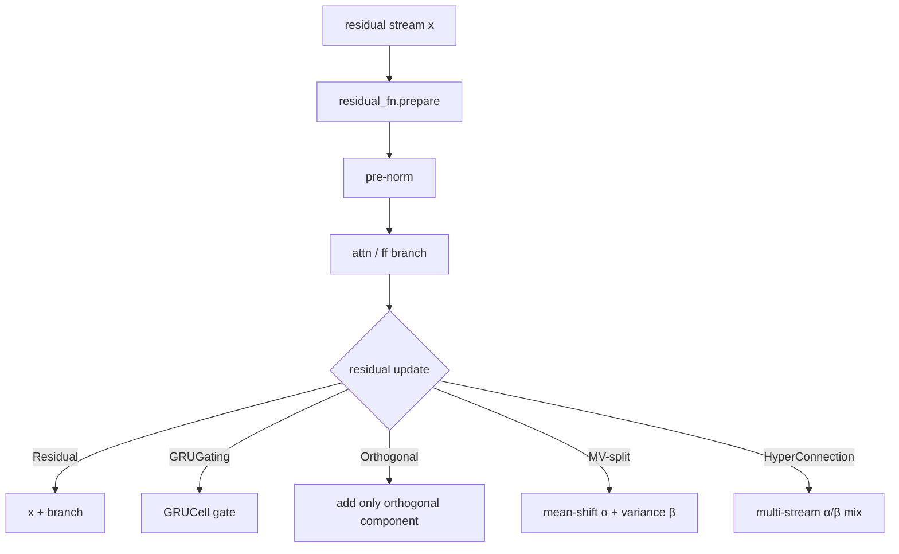

# Core Components

The building-block layers and their configuration flags. Flags marked
**(forward)** are passed per-call rather than at construction. Line references
are `x_transformers.py` (`xt`) / `attend.py` unless noted.

## 1. `Attention` (`xt:1695`)

Multi-head attention. Projects Q/K/V, optionally normalizes/gates them, delegates
score computation to `Attend`, then merges heads and projects out.

### Dimensions & head sharing
| Flag | Line | Effect |
|------|------|--------|
| `dim_head`, `heads` | 1699, 1701 | head size / count; `scale = dim_head ** -0.5` |
| `one_kv_head` | 1739 | MQA: a single shared K/V head |
| `kv_heads` | 1740 | GQA: `groups = heads // kv_heads` (mutually exclusive with `one_kv_head`) |
| `value_dim_head`, `dim_out` | 1741, 1742 | decoupled value head dim / output dim |

### QK normalization (cosine-sim attention)
`qk_norm` (1720) with `qk_norm_scale=10` (1722) and optional `qk_norm_dim_scale`
(1723, per-dim learned). Siblings: `qk_rmsnorm` (1724), `k_rmsnorm` (1725, K-only),
`value_rmsnorm` (1726) — built as `MultiheadRMSNorm`, applied at `xt:2211-2226`.

### Performance / attention backend
- `flash` (1703) → routes to `Attend.flash_attn` (`F.scaled_dot_product_attention`).
- `flash_pack_seq` (1774) → varlen flash for packed sequences.
- Alternate score fns: `sigmoid`, `hard`, `sparse_topk` (1708), `gumbel_softmax`,
  `l2_distance` — selected inside `Attend` (`attend.py:240-252`).

### Positional (forward-driven)
Rotary/polar embeddings are **not** built inside `Attention`; `AttentionLayers`
constructs them and passes tensors into `Attention.forward` **(forward)**:
`rotary_pos_emb` applied `xt:2249-2272`, partial rotary via `rotate_num_heads`
(1745). `data_dependent_alibi` (1746) / `_per_row` (1747) and `use_cope` (1750)
are built in-module.

### Gating & scaling
| Flag | Line | Idea |
|------|------|------|
| `gate_values` | 1716 | AlphaFold2 sigmoid GLU gate on output (bias init 10) |
| `swiglu_values` | 1715 | gate activation sigmoid → SiLU |
| `gate_value_heads` | 1714 | per-head output gating ("attend to nothing") |
| `head_scale` | 1707 | NormFormer per-head output scale `(1,heads,1,1)` |
| `learned_value_residual_mix` | 1756 | ResFormer value-residual mixer **(forward via `value_residual`)** |

### QKVO modulation (new, [arXiv 2605.12357])
No constructor flag — purely **(forward)** kwargs `q_delta, k_delta, v_delta,
o_delta, attn_delta` (`xt:2108-2112`). Q/K/V deltas added post-projection
(`xt:2179-2188`), O delta after head-merge (`xt:2479-2482`), `attn_delta` added
post-softmax inside `Attend` (`attend.py:618-619`). Modulation source is external.

### Advanced (brief)
MLA / multi-latent attention (`use_latent_q`, `use_latent_kv` 1763-1766);
`qkv_receive_diff_residuals` (1761, hyper-connections/LIMe); `laser`
(1759, exp-of-values); `orthog_projected_values` (1757, "belief attention");
`softclamp_logits` (1754); `head_learned_sink` (1744); `num_mem_kv` (1710).
Stability helpers: `qk_clip_()` (`xt:2058`), `muon_parameters()` (`xt:2083`).

## 2. `Attend` (`attend.py:185`)

Executes the attention score → softmax → weighted-sum, returning
`(out, Intermediates)`.

- **`Intermediates`** dataclass (`attend.py:20`): `qk_similarities`,
  `pre/post_softmax_attn`, `values`, `cached_kv`, `layer_type`, `log_probs`.
- **Dispatch** (`attend.py:540`): uses `flash_attn` only if `self.flash and not
  exists(attn_delta)`. Flash path → `F.scaled_dot_product_attention` under an
  SDP backend context manager (`attend.py:473`).
- **Manual path** (`attend.py:544-651`): einsum sim → optional `l2_distance` →
  scale → `prev_attn` residual → talking-heads → softclamp → masking → CoPE →
  selective → learned sink → `attn_fn` (softmax/variant) → `attn_delta` →
  dropout → weighted sum.
- **Causal mask**: triu mask (`create_causal_mask`); single-token KV-cache step
  disables it (`attend.py:519`).

## 3. `FeedForward` (`xt:1609`)

| Flag | Line | Effect |
|------|------|--------|
| `mult` | 1614 | hidden = `int(dim*mult)` |
| `glu` | 1615 | gated-linear-unit input projection (`GLU` `xt:1578`) |
| `swish` | 1617 | activation → SiLU (→ SwiGLU when `glu`) |
| `relu_squared` | 1618 | ReLU² activation (Primer) |
| `solu` | 1619 | SoLU activation |
| `post_act_ln` | 1621 | **NormFormer**: LayerNorm after activation |
| `no_bias` | 1624 | drop bias on both linears (PaLM) |
| `zero_init_output` | 1625 | zero-init final linear |
| `softclamp_value` | 1626 | **deepseek-style** softclamp between linear & activation |
| `glu_gate_softclamp_value` | 1627 | softclamp the GLU gate branch |
| `sublayer_dropout` | 1623 | dropout after out-projection |

## 4. Normalization

| Class | Line | Distinctive |
|-------|------|-------------|
| `LayerNorm` | 918 | bias-less; manual `gamma`; `unit_offset` for safe weight decay |
| `AdaptiveLayerNorm` | 939 | gamma from a `condition` vector (DiT-style, `gamma+1`) |
| `ScaleNorm` | 960 | single scalar `g` |
| `RMSNorm` | 977 | per-dim `g`, `F.normalize`×√dim |
| `AdaptiveRMSNorm` | 994 | RMSNorm with conditioned gamma |
| `SimpleRMSNorm` | 1015 | no learned gamma |
| `MultiheadRMSNorm` | 1027 | per-head gamma; used for qk/value rmsnorm |
| `DynamicTanh` | 1036 | norm-free `tanh(αx)·γ+β` ([arXiv 2503.10622]) |
| `Derf` | 1063 | norm-free `erf(αx+s)·γ+β` ([arXiv 2512.10938]) |

Selected in `AttentionLayers` via `use_scalenorm / use_rmsnorm /
use_simple_rmsnorm / use_dynamic_tanh / use_derf / use_adaptive_*`
(`xt:2536-2543`); default `LayerNorm`. `norm_add_unit_offset` (`xt:2545`).

## 5. Residual / update strategies

All implement `.prepare(residual)` + `forward(branch_out, residual, ...)`,
selected in the layer loop at `xt:2967-2982`.

| Class | Line | Idea | Enabling flag |
|-------|------|------|---------------|
| `Residual` | 1090 | `x + residual`; optional learned `scale_residual` | default; `scale_residual` (2584) |
| `GRUGating` | 1108 | gate residual via `nn.GRUCell` | `gate_residual` (2581) |
| `OrthogonalResidualUpdate` | 1128 | add only branch component orthogonal to residual ([arXiv 2505.11881]) | `orthog_residual` (2582) |
| `MVSplitResidualUpdate` | 1151 | mean-variance split: mean-shift (α) + centered/variance (β), optional learned MLPs ([arXiv 2605.06169]) | `mv_split_residual` (2583) |
| `AttentionAggregatedResidual` | 1192 | attention-pool over all prior hiddens to form residual | `attn_aggregated_residuals` (2578) |
| `HyperConnection` | 1308 | learned multi-stream residual mixing (Sinkhorn α/β; [arXiv 2409.19606]) | `num_residual_streams > 1` (2599) |

> `orthog_residual` (a residual update) ≠ `orthog_projected_values` (an Attention
> feature). Value-residual (ResFormer) is the separate `add_value_residual`
> (2603) toggle.

## 6. Positional encodings

| Class | Line | One-line | Selecting flag |
|-------|------|----------|----------------|
| `AbsolutePositionalEmbedding` | 397 | learned position table | `use_abs_pos_emb` (default) |
| `ScaledSinusoidalEmbedding` | 425 | sinusoidal + learned scale | `scaled_sinu_pos_emb` |
| `RelativePositionBias` | 455 | T5 bucketed relative bias | `rel_pos_bias` (no flash) |
| `CoPE` | 500 | contextual positional encoding ([arXiv 2405.18719]) | `use_cope` (causal, no flash) |
| `DynamicPositionBias` | 561 | MLP: rel-distance → per-head bias | `dynamic_pos_bias` |
| `AlibiPositionalBias` | 612 | fixed per-head linear slopes | `alibi_pos_bias` |
| `DataDependentAlibi` | 683 | input-dependent forget-gate bias (Forgetting Transformer) | `data_dependent_alibi` |
| `PerRowDataDependentAlibi` | 727 | per-row forget gates | `+ data_dependent_alibi_per_row` |
| `RotaryEmbedding` | 773 | RoPE (+xpos, NTK) | `rotary_pos_emb` / `rotary_xpos` |
| `PolarEmbedding` | 857 | PoPE: softplus-magnitude polar ([arXiv 2509.10534]) | `polar_pos_emb` |

Relative/rotary/polar auto-disable absolute pos emb (`disable_abs_pos_emb`,
`xt:2656`).

## 7. Embeddings (`TransformerWrapper`)

- `TokenEmbedding` (`xt:379`): `nn.Embedding` + optional `l2norm_embed`,
  instantiated at `xt:3706` (or injected via `token_emb`).
- Abs-pos vs rotary (`xt:3711-3718`): when the `AttentionLayers` sets a
  relative/rotary/polar scheme, `pos_emb = always(0)` — **rotary auto-disables
  absolute pos emb**.
- Extras: `post_emb_norm` (3657), `emb_frac_gradient` (3671), `embed_num_tokens`
  (3652), `ff_deep_embed` value embedding (3685).

## 8. Quick config-flag reference (most-used)

| Goal | Flags |
|------|-------|
| GPT-style decoder | `Decoder(dim, depth, heads)` (causal auto) |
| RoPE, no abs pos | `rotary_pos_emb=True` (abs auto-off) |
| GQA / MQA | `attn_kv_heads=k` / `attn_one_kv_head=True` |
| QK-norm attention | `attn_qk_norm=True` |
| SwiGLU FFN (PaLM) | `ff_glu=True, ff_swish=True, ff_no_bias=True` |
| NormFormer | `attn_head_scale=True, ff_post_act_ln=True, scale_residual=True, sandwich_norm=True` |
| Flash attention | `attn_flash=True` |
| Orthogonal residual | `orthog_residual=True` |
| MV-split residual | `mv_split_residual=True` |
| Hyper-connections | `num_residual_streams=N` |
| Looped LM | `looped=True` (requires `pre_and_post_norm=True`) |

[arXiv 2605.12357]: https://arxiv.org/abs/2605.12357
[arXiv 2503.10622]: https://arxiv.org/abs/2503.10622
[arXiv 2512.10938]: https://arxiv.org/abs/2512.10938
[arXiv 2505.11881]: https://arxiv.org/abs/2505.11881
[arXiv 2605.06169]: https://arxiv.org/abs/2605.06169
[arXiv 2409.19606]: https://arxiv.org/abs/2409.19606
[arXiv 2405.18719]: https://arxiv.org/abs/2405.18719
[arXiv 2509.10534]: https://arxiv.org/abs/2509.10534
