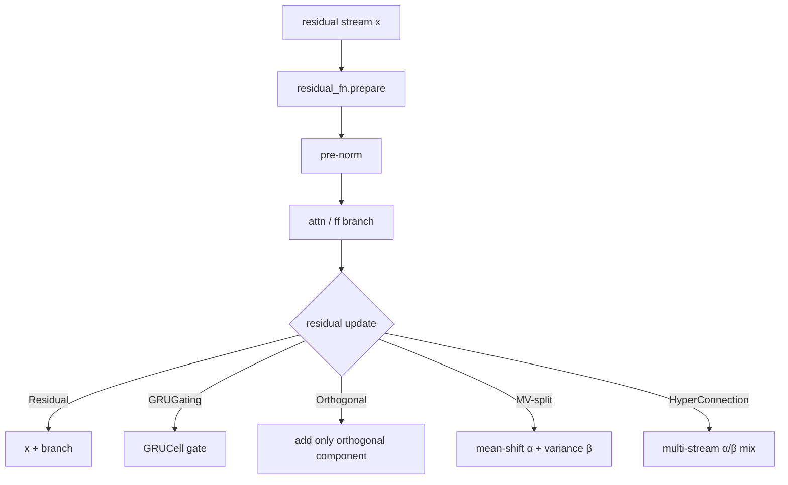

# Core Components

The building-block layers and their configuration flags. Flags marked
**(forward)** are passed per-call rather than at construction. Code references
are symbol anchors of the form `<abbrev>::Class.method` — a dotted Python path
resolvable with ripgrep or ctags, so they survive re-annotation and upstream
merges; `scripts/check_doc_symbols.py` verifies they all still resolve. Module
abbreviations: `xt` = `x_transformers.py`, `attend` = `attend.py`. Tracks
upstream **v2.24.0**.

## 1. `Attention` (`xt::Attention`)

Multi-head attention. Projects Q/K/V, optionally normalizes/gates them, delegates
score computation to `Attend`, then merges heads and projects out.

### Dimensions & head sharing
| Flag | Effect |
|------|--------|
| `dim_head`, `heads` | head size / count; `scale = dim_head ** -0.5` |
| `one_kv_head` | MQA: a single shared K/V head |
| `kv_heads` | GQA: `groups = heads // kv_heads` (mutually exclusive with `one_kv_head`) |
| `value_dim_head`, `dim_out` | decoupled value head dim / output dim |

### QK normalization (cosine-sim attention)
`qk_norm` with `qk_norm_scale=10` and optional `qk_norm_dim_scale` (per-dim
learned). Siblings: `qk_rmsnorm`, `k_rmsnorm` (K-only), `value_rmsnorm` — built
as `xt::MultiheadRMSNorm`, applied inside `xt::Attention.forward`.

### Performance / attention backend
- `flash` → routes to `attend::Attend.flash_attn` (`F.scaled_dot_product_attention`).
- `flash_pack_seq` → varlen flash for packed sequences; the `flash_pack_seq_kwargs`
  **(forward)** dict carries `cu_seqlens_*` / `max_seqlen_*` through untouched.
- Alternate score fns: `sigmoid`, `hard`, `sparse_topk`, `gumbel_softmax`,
  `l2_distance` — selected inside `attend::Attend.__init__`.

### Positional (forward-driven)
Rotary/polar embeddings are **not** built inside `Attention`; `AttentionLayers`
constructs them and passes tensors into `xt::Attention.forward` **(forward)**:
`rotary_pos_emb` applied via `xt::apply_rotary_pos_emb`, partial rotary via
`rotate_num_heads`. `data_dependent_alibi` / `_per_row`, `use_cope` and
`use_rel_proj_pos_bias` (see §6) are built in-module.

### Inverted attention
`inverted_attention` (`xt::Attention`) forwards to `attend::Attend` and makes
`xt::Attention.forward` pass `row_mask = mask` — the untouched query-side padding
mask — alongside the key-side `mask = final_attn_mask` at its `self.attend(...)`
call. `xt::AttentionLayers.__init__` pops the flag out of `attn_kwargs` so it can
never land on a self-attention layer, and reads it only from the `cross_attn_`
group (a single bool, or one bool per cross-attention layer); it emits a
`logger.warning` when `causal` is set together with any inverted cross attention.
Mechanism in §2.

### Gating & scaling
| Flag | Idea |
|------|------|
| `gate_values` | AlphaFold2 sigmoid GLU gate on output (bias init 10) |
| `swiglu_values` | gate activation sigmoid → SiLU |
| `gate_value_heads` | per-head output gating ("attend to nothing") |
| `head_scale` | NormFormer per-head output scale `(1,heads,1,1)` |
| `learned_value_residual_mix` | ResFormer value-residual mixer **(forward via `value_residual`)** |

### QKVO modulation ([arXiv 2605.12357])
No constructor flag — purely **(forward)** kwargs `q_delta, k_delta, v_delta,
o_delta, attn_delta` on `xt::Attention.forward`. Q/K/V deltas added
post-projection, O delta after head-merge, `attn_delta` added post-softmax inside
`attend::Attend.forward`. Modulation source is external.

### Advanced (brief)
MLA / multi-latent attention (`use_latent_q`, `use_latent_kv`);
`qkv_receive_diff_residuals` (hyper-connections/LIMe); `laser` (exp-of-values);
`orthog_projected_values` ("belief attention"); `softclamp_logits`;
`head_learned_sink`; `num_mem_kv`; `sublayer_dropout`. All are `xt::Attention`
constructor flags. Stability helpers: `xt::Attention.qk_clip_`,
`xt::Attention.muon_parameters`.

## 2. `Attend` (`attend::Attend`)

Executes the attention score → softmax → weighted-sum, returning
`(out, Intermediates)`.

- **`attend::Intermediates`** dataclass: `qk_similarities`,
  `pre/post_softmax_attn`, `values`, `cached_kv`, `layer_type`, `hybrid_hidden`,
  `log_probs`.
- **Dispatch** (`attend::Attend.forward`): uses `attend::Attend.flash_attn` only
  if `self.flash and not exists(attn_delta)`. Flash path →
  `F.scaled_dot_product_attention` under an SDP backend context manager.
- **Manual path**: einsum sim → optional `attend::qk_l2_dist_squared` → scale →
  `prev_attn` residual → talking-heads → softclamp → masking → CoPE →
  `attend::selective_attn` → learned sink → `attn_fn` (softmax/variant) → inverted
  renormalization → `attn_delta` → dropout → weighted sum.
- **Causal mask**: triu mask (`attend::create_causal_mask`, or
  `attend::onnx_create_causal_mask`); single-token KV-cache step disables it.
- **Packed-sequence varlen**: under `flash_pack_seq` the batch must be 1 and no
  dense `mask` may be given; `q/k/v` are flattened to `(n h d)` and
  `flash_pack_seq_kwargs` is forwarded to `flash_attn_varlen_func` verbatim
  (upstream dropped the older shape/monotonicity validation of `cu_seqlens`).

### Inverted attention (`inverted_attention`)
Ordinary attention normalizes over `j` (keys), so each query spreads one unit of
mass across the keys. Inverted sets `attn_dim = -2`, normalizing over `i`
(queries), so queries compete for each key — the slot-attention arrangement
([openreview WgQZNoQ5AB]). The axis is bound into the axis-taking score fns
(`F.softmax`, `F.gumbel_softmax`, `attend::sparse_topk_attn`,
`attend::one_hot_straight_through` — the last two grew a `dim` argument for this);
`sigmoid` is elementwise and a `custom_attn_fn` is left alone.

| Stage | Ordinary | Inverted |
|-------|----------|----------|
| pre-softmax mask | key mask `mask`, shaped `b 1 1 j` | query mask `row_mask`, reshaped `b 1 i 1` |
| `attn_fn` axis | `-1` (keys) | `-2` (queries) |
| post-softmax | — | zero the padded keys, then `attend::l1norm` per row |

Masking keys *before* a query-axis softmax would be a no-op, hence the swap; the
key mask is instead applied after the softmax, and the l1 renormalization puts
each query row back to summing to 1 so the value aggregation is a weighted mean
again. Asserted incompatible with flash in `attend::Attend.__init__`.

## 3. `FeedForward` (`xt::FeedForward`)

| Flag | Effect |
|------|--------|
| `mult` | hidden = `int(dim*mult)` |
| `glu` | gated-linear-unit input projection (`xt::GLU`) |
| `swish` | activation → SiLU (→ SwiGLU when `glu`) |
| `relu_squared` | ReLU² activation (Primer, `xt::ReluSquared`) |
| `solu` | SoLU activation (`xt::SoLU`) |
| `custom_activation` | deep-copied activation module, overrides the above |
| `post_act_ln` | **NormFormer**: LayerNorm after activation |
| `no_bias` | drop bias on both linears (PaLM) |
| `zero_init_output` | zero-init final linear |
| `softclamp_value` | **deepseek-style** softclamp between linear & activation |
| `glu_gate_softclamp_value` | softclamp the GLU gate branch |
| `sublayer_dropout` | dropout after out-projection |

### Per-layer schedules (`xt::layer_schedule`)
`layer_schedule(start, end, depth, schedule = 'cosine')` returns a `depth`-length
tuple stepping one hyperparameter from `start` at layer 0 to `end` at layer
`depth - 1`, evaluating `schedule(start, end, l / (depth - 1))`. `schedule` is
`'linear'`, `'cosine'` (half cosine period, easing at both endpoints), or any
callable `(start, end, t)`; `depth > 1` is asserted. Exported from the package
root.

`xt::AttentionLayers.__init__` indexes any layer kwarg whose value is a tuple
whose length matches that layer kind's count, and passes anything else through
unchanged — a tuple of some other length therefore stays a scalar value. So
`ff_mult = layer_schedule(6, 2, depth = 12)` gives a feedforward expansion factor
that descends with depth ([arXiv 2606.23670]), and `attn_dropout` / `ff_dropout`
work the same way. A depth-length `attn_*` schedule is dropped before `attn_kwargs`
is merged into the cross-attention kwargs, so it is not re-indexed against a
different cross-attention layer count. A hand-written tuple of length `depth`
bypasses the helper entirely.

## 4. Normalization

| Class | Symbol | Distinctive |
|-------|--------|-------------|
| `LayerNorm` | `xt::LayerNorm` | bias-less; manual `gamma`; `unit_offset` for safe weight decay |
| `AdaptiveLayerNorm` | `xt::AdaptiveLayerNorm` | gamma from a `condition` vector (DiT-style, `gamma+1`) |
| `ScaleNorm` | `xt::ScaleNorm` | single scalar `g` |
| `RMSNorm` | `xt::RMSNorm` | per-dim `g`, `F.normalize`×√dim |
| `AdaptiveRMSNorm` | `xt::AdaptiveRMSNorm` | RMSNorm with conditioned gamma |
| `SimpleRMSNorm` | `xt::SimpleRMSNorm` | no learned gamma |
| `MultiheadRMSNorm` | `xt::MultiheadRMSNorm` | per-head gamma; used for qk/value rmsnorm |
| `DynamicTanh` | `xt::DynamicTanh` | norm-free `tanh(αx)·γ+β` ([arXiv 2503.10622]) |
| `Derf` | `xt::Derf` | norm-free `erf(αx+s)·γ+β` ([arXiv 2512.10938]) |

Selected in `xt::AttentionLayers.__init__` via `use_scalenorm / use_rmsnorm /
use_simple_rmsnorm / use_dynamic_tanh / use_derf / use_adaptive_*` (mutually
exclusive); default `LayerNorm`. `norm_add_unit_offset` defaults to `True`.

## 5. Residual / update strategies

The `residual_fn` family all implement `.prepare(residual)` +
`forward(branch_out, residual, ...)`, and one of them is picked in
`xt::AttentionLayers.__init__`; `.prepare` is then called once per layer in
`xt::AttentionLayers.forward`.

| Class | Symbol | Idea | Enabling flag |
|-------|--------|------|---------------|
| `Residual` | `xt::Residual` | `x + residual`; optional learned `scale_residual` | default; `scale_residual` |
| `GRUGating` | `xt::GRUGating` | gate residual via `nn.GRUCell` | `gate_residual` |
| `OrthogonalResidualUpdate` | `xt::OrthogonalResidualUpdate` | add only branch component orthogonal to residual, via `xt::orthog_project` ([arXiv 2505.11881]) | `orthog_residual` |
| `MVSplitResidualUpdate` | `xt::MVSplitResidualUpdate` | mean-variance split: mean-shift (α) + centered/variance (β), optional learned MLPs ([arXiv 2605.06169]) | `mv_split_residual` |
| `HyperConnection` | `xt::HyperConnection` | learned multi-stream residual mixing (`xt::sinkhorn` α/β; [arXiv 2409.19606]) | `num_residual_streams > 1` |

`gate_residual`, `orthog_residual`, `mv_split_residual` and
`attn_aggregated_residuals` are mutually exclusive, and the first three may not be
combined with hyper-connections.

### Layer integrators (a separate slot)
Applied to `x` *before* the pre-norm, recombining all prior layer hiddens rather
than updating the residual — so despite the name these have no `.prepare` and are
not `residual_fn` choices:

| Class | Symbol | Idea | Enabling flag |
|-------|--------|------|---------------|
| `DynamicLIMe` | `xt::DynamicLIMe` | learned per-token weighting over prior layer hiddens | `integrate_layers` |
| `AttentionAggregatedResidual` | `xt::AttentionAggregatedResidual` | attention-pool over all prior hiddens, with rotary/polar encoding the layer-depth distance | `attn_aggregated_residuals` |

> `orthog_residual` (a residual update) ≠ `orthog_projected_values` (an
> `xt::Attention` feature). Value-residual (ResFormer) is the separate
> `add_value_residual` toggle.

## 6. Positional encodings

| Class | Symbol | One-line | Selecting flag |
|-------|--------|----------|----------------|
| `AbsolutePositionalEmbedding` | `xt::AbsolutePositionalEmbedding` | learned position table | `use_abs_pos_emb` (default) |
| `ScaledSinusoidalEmbedding` | `xt::ScaledSinusoidalEmbedding` | sinusoidal + learned scale | `scaled_sinu_pos_emb` |
| `RelativePositionBias` | `xt::RelativePositionBias` | T5 bucketed relative bias | `rel_pos_bias` (no flash) |
| `CoPE` | `xt::CoPE` | contextual positional encoding ([arXiv 2405.18719]) | `use_cope` (causal, no flash) |
| `DynamicPositionBias` | `xt::DynamicPositionBias` | MLP: rel-distance → per-head bias | `dynamic_pos_bias` |
| `AlibiPositionalBias` | `xt::AlibiPositionalBias` | fixed per-head linear slopes | `alibi_pos_bias` |
| `DataDependentAlibi` | `xt::DataDependentAlibi` | input-dependent forget-gate bias (Forgetting Transformer) | `data_dependent_alibi` |
| `PerRowDataDependentAlibi` | `xt::PerRowDataDependentAlibi` | per-row forget gates | `+ data_dependent_alibi_per_row` |
| `RelativeProjPositionalBias` | `xt::RelativeProjPositionalBias` | per-token projected mixture over a shared bank of distance curves — Inkling (Thinking Machines); source cites no paper | `attn_use_rel_proj_pos_bias` |
| `RotaryEmbedding` | `xt::RotaryEmbedding` | RoPE (+xpos, NTK) | `rotary_pos_emb` / `rotary_xpos` |
| `PolarEmbedding` | `xt::PolarEmbedding` | PoPE: softplus-magnitude polar ([arXiv 2509.10534]) | `polar_pos_emb` |

Relative/rotary/polar auto-disable absolute pos emb (`disable_abs_pos_emb`,
`xt::AttentionLayers.__init__`).

### `RelativeProjPositionalBias` (content-dependent alibi alternative)
The module owns `distance_bank`, a `(num_distance_basis, max_dist)` parameter:
one row per shared basis curve, one column per relative distance. Its
`to_distance_weights` linear projects the query-side input to per-token, per-head
mixing weights `(b h n num_distance_basis)`, which contract against the bank to
collapse it into a single bias-versus-distance curve for every (token, head)
pair. The `(b h i j)` bias is that curve gathered at the query-to-key relative
distance, so the profile a query sees comes from its own content rather than a
fixed per-head slope. Query positions are right-aligned against the keys
(`pos_q = arange(n) + (seq_len_k - n)`) so cached keys keep the distances they had
at prefill. Negative distances (future keys) and distances `>= max_dist` are
zeroed after the gather. Constructor flags on `xt::Attention`:
`use_rel_proj_pos_bias`, `rel_proj_num_distance_basis` (default 16),
`rel_proj_max_dist` (default 1024). Unlike alibi and data-dependent alibi, it
*accumulates* onto any existing `attn_bias` in `xt::Attention.forward` rather than
replacing it.

## 7. Embeddings (`xt::TransformerWrapper`)

- `xt::TokenEmbedding`: `nn.Embedding` + optional `l2norm_embed`, instantiated in
  `xt::TransformerWrapper.__init__` (or injected via `token_emb`).
- Abs-pos vs rotary: when the `AttentionLayers` sets a relative/rotary/polar
  scheme, `pos_emb = always(0)` — **rotary auto-disables absolute pos emb**.
- Extras: `post_emb_norm`, `emb_frac_gradient`, `embed_num_tokens`, `ff_deep_embed`
  value embedding.

## 8. Quick config-flag reference (most-used)

| Goal | Flags |
|------|-------|
| GPT-style decoder | `Decoder(dim, depth, heads)` (causal auto) |
| RoPE, no abs pos | `rotary_pos_emb=True` (abs auto-off) |
| Inkling relative bias | `attn_use_rel_proj_pos_bias=True` (+ `attn_rel_proj_num_distance_basis`, `attn_rel_proj_max_dist`) |
| GQA / MQA | `attn_kv_heads=k` / `attn_one_kv_head=True` |
| QK-norm attention | `attn_qk_norm=True` |
| SwiGLU FFN (PaLM) | `ff_glu=True, ff_swish=True, ff_no_bias=True` |
| Descending FF dim | `ff_mult=layer_schedule(6, 2, depth=depth)` |
| Depth-varying dropout | `attn_dropout=layer_schedule(0., .5, depth=depth, schedule='linear')` |
| NormFormer | `attn_head_scale=True, ff_post_act_ln=True, scale_residual=True, sandwich_norm=True` |
| Flash attention | `attn_flash=True` |
| Inverted cross attention | `cross_attend=True, cross_attn_inverted_attention=True` (no flash; warns under a causal decoder) |
| Orthogonal residual | `orthog_residual=True` |
| MV-split residual | `mv_split_residual=True` |
| Hyper-connections | `num_residual_streams=N` |
| Looped LM | `looped=True` (requires `pre_and_post_norm=True`) |

[arXiv 2605.12357]: https://arxiv.org/abs/2605.12357
[arXiv 2503.10622]: https://arxiv.org/abs/2503.10622
[arXiv 2512.10938]: https://arxiv.org/abs/2512.10938
[arXiv 2505.11881]: https://arxiv.org/abs/2505.11881
[arXiv 2605.06169]: https://arxiv.org/abs/2605.06169
[arXiv 2409.19606]: https://arxiv.org/abs/2409.19606
[arXiv 2405.18719]: https://arxiv.org/abs/2405.18719
[arXiv 2509.10534]: https://arxiv.org/abs/2509.10534
[arXiv 2606.23670]: https://arxiv.org/abs/2606.23670
[openreview WgQZNoQ5AB]: https://openreview.net/forum?id=WgQZNoQ5AB
