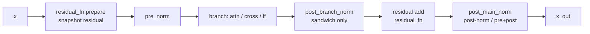
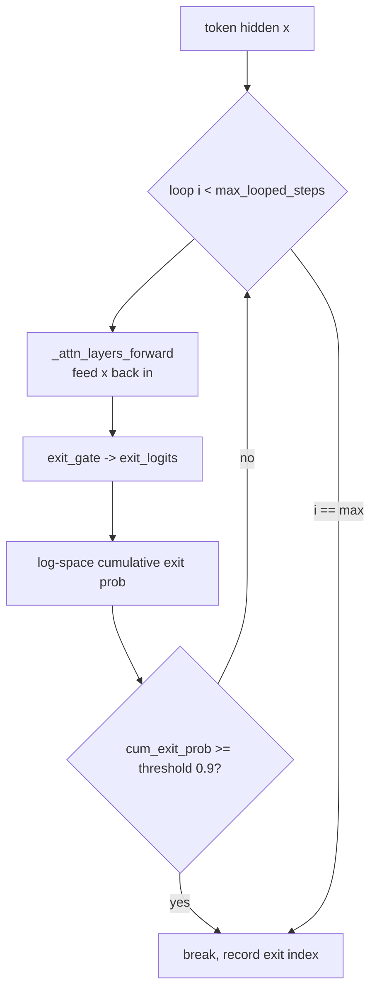
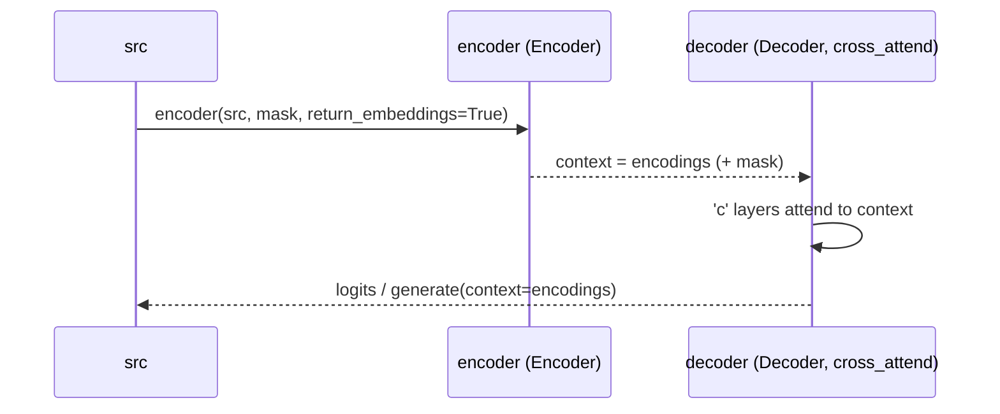

# Model & Inference Flow

How data moves through the stack at train and inference time: the per-layer
forward, KV caching, autoregressive `generate`, looped/early-exit decoding,
encoder-decoder cross-attention, and Transformer-XL segment memory. References
are `x_transformers.py` (`xt`) / `autoregressive_wrapper.py` (`arw`) /
`xl_autoregressive_wrapper.py` (`xl`).

## 1. Forward pass — `AttentionLayers.forward`

The layer schedule is precomputed in `__init__` as `layer_types`, a sequence of
`'a'` (self-attn), `'c'` (cross-attn), `'f'` (feedforward) tokens (default block
`('a','c','f')` with cross-attend, else `('a','f')`; `xt:2760-2768`). Each entry
becomes a `ModuleList([norms, block, residual_fn])` (`xt:2994-3012`).

### Per-layer order


Key fact: the residual is snapshotted **before** the pre-norm
(`x, inner_residual, ... = residual_fn.prepare(x)`, `xt:3337`), the branch sees
the normalized input, then the residual is recombined (`xt:3394`).

### Norm placement (which norm modules exist)
| Mode | Condition | Ref |
|------|-----------|-----|
| `pre_branch_norm` | iff `pre_norm` | `xt:2994` |
| `post_branch_norm` (sandwich) | iff `sandwich_norm` (requires pre-norm) | `xt:2695, 2995` |
| `post_main_norm` | iff `not pre_norm` **or** `pre_and_post_norm` | `xt:2996` |
| final norm | iff `pre_norm and pre_norm_has_final_norm` else `Identity` | `xt:2878` |

`pre_and_post_norm` forces `pre_norm=True` and turns the per-main final norm on
while disabling the stack's final norm (`xt:2704-2708`) — this is the mode the
looped LM requires (§4).

> `repeat_blocks` / `layers_execute_order` can repeat blocks at forward time for
> recurrent-depth experiments (`xt:3240-3248`).

## 2. KV caching

Two dataclasses carry cache state:

- **`LayerIntermediates`** (`xt:48`): `attn_intermediates` (per-attn-layer),
  `cache_length`, `mems` (XL), and looped-LM fields `exit_logits`,
  `all_pred_logits`, `exit_indices`, `looped_prompt_kv_cache`. `__copy__`
  deep-copies the intermediates list (`xt:64-70`).
- **`Intermediates`** (`attend.py:20`): holds `cached_kv` per attention layer.

Threading (`AttentionLayers.forward`): with a cache, the code asserts causal +
no `attn_mask`, sets `seq_pos_offset = cache.cache_length`, truncates the input
to the un-cached tail (`x = x[:, -cache_age:]`, `xt:3187-3203`), and hands each
attn/cross layer `cache = next(iter_attn_cache)` (`xt:3377/3379`).
Production/consumption happens in `Attention.forward`: consume
`k = cat((ck, k))`, `v = cat((cv, v))` (`xt:2231-2243`), produce
`cached_kv = (k, v)` excluding memory tokens (`xt:2246-2247, 2523`).

`TransformerWrapper` gates caching: `can_cache_kv` requires no memory tokens and
no recycling (`xt:3861`); KV caching beyond `max_seq_len` is allowed only when
there is no absolute pos emb (`xt:3862`).

## 3. `AutoregressiveWrapper.generate`

Signature defaults `filter_logits_fn=top_k, temperature=1., cache_kv=True`
(`arw:692`).

```mermaid
sequenceDiagram
    participant U as caller
    participant G as generate loop
    participant N as net (TransformerWrapper)
    U->>G: prompt(s), seq_len
    loop seq_len steps
        G->>N: net(x[-max_seq_len:], cache, seq_start_pos, return_intermediates)
        N-->>G: logits, cache
        G->>G: logits[:, -1]; filter (top-k/p/a, min-p)
        G->>G: greedy if temp==0 else multinomial(softmax(filtered/temp))
        G->>G: append token; stop if all EOS
    end
    G-->>U: out[:, prompt_len:]
```

- **Filters**: `top_p` (`arw:252`), `top_k` (`284`), `top_a` (`312`), `min_p`
  (`337`); string registry `FILTER_LOGITS_FN` (`363`).
- **Variable-length prompts**: padded + `align_right`, `seq_start_pos = t -
  prompt_lens` (`arw:778-781`).
- **Cache** updated only when `cache_kv and net.can_cache_kv` (`arw:844`).
- **Contrastive decoding** (`amateur_model`): expert vs amateur logits combined
  with cutoff `log(α)+max(expert)` (`arw:373-410, 852-874`); forces
  `filter_logits_fn = identity`.
- **Not present**: classifier-free guidance (`cfg`) and restrict-token-list
  decoding. The only "restrict" is `restrict_to_max_seq_len` (length truncation).
- `beam_search` also available (`arw:482-690`).

## 4. Looped / early-exit inference

Looped LM (Zhu et al., [arXiv 2510.25741]) re-applies the same stack up to
`max_looped_steps` (default 4; can extrapolate to 5-8 at inference) and learns an
**exit gate** to stop early per token. Requires `pre_and_post_norm` (`xt:3766`);
`exit_gate = LinearNoBias(dim, 1)` (`xt:3769`).



Early-exit math (log-space, `xt:4143-4167`):

```
exit_logprob     = logsigmoid(exit_logits)
continue_logprob = logsigmoid(-exit_logits)
step_exit_prob   = (cum_continue_logprob + exit_logprob).exp()
cum_exit_prob   += step_exit_prob
should_exit      = cum_exit_prob >= looped_exit_prob_threshold   # default 0.9
cum_continue_logprob += continue_logprob
```

- One token per step when cached (`xt:4090`); a dedicated
  `looped_prompt_kv_cache[i]` is kept per loop index (`xt:4111-4120, 4183-4186`).
- `exit_indices` records the chosen loop depth per token (`safe_cat` across the
  decode, `xt:4176-4179`) — useful for studying depth extrapolation.
- **Training the gate** (`arw:1017-1083`): per-loop CE losses → target
  `sigmoid(slope·(Δloss + threshold))` (slope 50) → BCE exit loss, weighted by
  log-space exit probabilities.
- **Sibling**: recycling (AlphaFold2-style, `xt:4188-4204`) detaches the recycled
  projection except on the last step; disables KV caching.

## 5. Encoder-decoder cross-attention (`XTransformer`)



- `generate`: `encodings = encoder(...)` then `decoder.generate(..., context=
  encodings, context_mask=mask)` (`xt:4396-4399`).
- Inside `AttentionLayers.forward`, `'c'` layers receive `context`/`context_mask`
  (`xt:3379`); assert `not (cross_attend ^ exists(context))` (`xt:3085`).
- With a cache, cross-context is zeroed (`context = context[:, :0]`) because
  cross-KV is already cached (`xt:3192-3193`).

## 6. Transformer-XL segment memory (`XLAutoregressiveWrapper`)

Splits long sequences into `max_seq_len` segments and carries detached hidden
states (`mems`) across segments, distinct from intra-segment `cached_kv`.

- **generate**: run leading segments to build `mems` (`return_mems=True`,
  discard logits, `xl:139-152`), then decode the tail, advancing
  `curr_mems = mems` at each segment boundary (`xl:167-208`).
- **train**: chunk `x`/`labels` into segments, forward each with the prior
  segment's `mems`, accumulate length-weighted CE (`xl:274-321`).
- **memory production** (`TransformerWrapper`, `return_mems`):
  `new_mems = [cat(pair) for pair in zip(mems, hiddens)]`, truncated to
  `max_mem_len` and detached (`xt:4332-4340`).

[arXiv 2510.25741]: https://arxiv.org/abs/2510.25741
