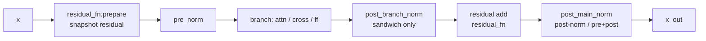
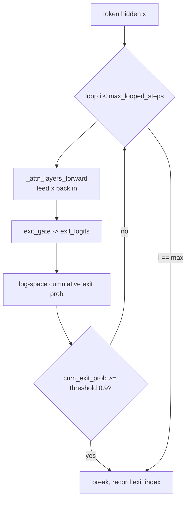
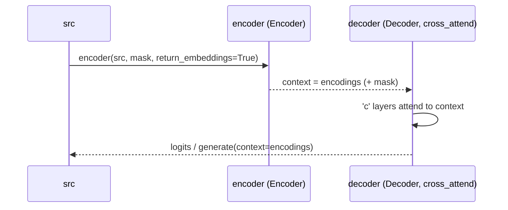
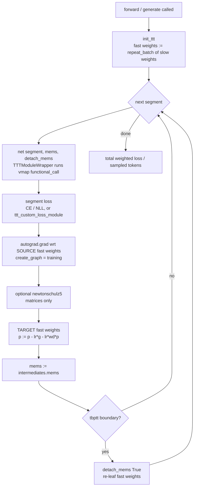
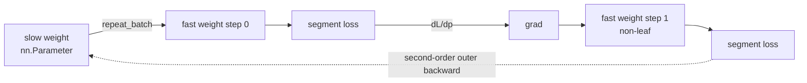
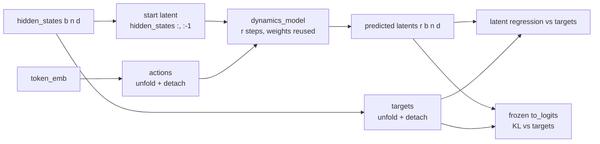

# Model & Inference Flow

How data moves through the stack at train and inference time: the per-layer
forward, KV caching, autoregressive `generate`, looped/early-exit decoding,
encoder-decoder cross-attention, Transformer-XL segment memory, end-to-end
test-time training, and latent-space rollouts.

Code references here are **symbol anchors**, not line numbers. `` `xt::AttentionLayers.forward` ``
means the dotted Python path `AttentionLayers.forward` inside `x_transformers.py`.
Each one is an exact `Class`, `Class.method` or module-level name, so it resolves
with a single ripgrep or ctags lookup and survives re-annotation and upstream
merges. Abbreviations used below: `xt` = `x_transformers.py`, `attend` =
`attend.py`, `arw` = `autoregressive_wrapper.py`, `xl` =
`xl_autoregressive_wrapper.py`, `nlw` = `next_latent_wrapper.py`, `lejepa` =
`gpt_lejepa.py`. Constructor kwargs and instance attributes are not symbols, so
they are written in prose with their owning class in parentheses — e.g.
`looped_exit_prob_threshold` (`xt::TransformerWrapper`). `scripts/check_doc_symbols.py`
verifies that every anchor still resolves. This doc tracks upstream v2.24.0.

## 1. Forward pass — `AttentionLayers.forward`

The layer schedule is precomputed in `xt::AttentionLayers.__init__` as
`layer_types`, a sequence of `'a'` (self-attn), `'c'` (cross-attn), `'f'`
(feedforward) tokens. The default block is `('a','c','f')` with cross-attend,
`('c','f')` for cross-only, else `('a','f')`, with a leading `'f'` prepended
under `macaron`. Each entry becomes a `ModuleList([norms, block, residual_fn])`.

### Per-layer order


Key fact: the residual is snapshotted **before** the pre-norm
(`x, inner_residual, residual_kwargs = residual_fn.prepare(x)` in
`xt::AttentionLayers.forward`; see `xt::Residual.prepare` and its siblings
`xt::GRUGating.prepare`, `xt::HyperConnection.prepare`), the branch sees the
normalized input, then the residual is recombined by calling `residual_fn`.

### Norm placement (which norm modules exist)
| Mode | Condition | Ref |
|------|-----------|-----|
| `pre_branch_norm` | iff `pre_norm` | `xt::AttentionLayers.__init__` |
| `post_branch_norm` (sandwich) | iff `sandwich_norm` (requires pre-norm) | `xt::AttentionLayers.__init__` |
| `post_main_norm` | iff `not pre_norm` **or** `pre_and_post_norm` | `xt::AttentionLayers.__init__` |
| final norm | iff `pre_norm and pre_norm_has_final_norm` else `Identity` | `xt::AttentionLayers.__init__` |

`pre_and_post_norm` (`xt::AttentionLayers`) forces `pre_norm = True` and turns
the per-main final norm on while disabling the stack's final norm
(`pre_norm_has_final_norm = False`, since post-norm already normalizes the
output) — this is the mode the looped LM requires (§4).

> `repeat_blocks` / `layers_execute_order` can repeat blocks at forward time for
> recurrent-depth experiments (`xt::resolve_repeat_blocks_to_layer_execute_order`,
> `xt::layer_schedule`).

## 2. KV caching

Two dataclasses carry cache state:

- **`xt::LayerIntermediates`**: `hiddens` (residual stream captured before each
  self-attn layer), `last_layer_hiddens`, `attn_intermediates` (per-attn-layer),
  `cache_length`, `mems` (XL), and looped-LM fields `exit_logits`,
  `all_pred_logits`, `exit_indices`, `looped_prompt_kv_cache`.
  `xt::LayerIntermediates.__copy__` deep-copies the intermediates list.
- **`attend::Intermediates`**: holds `cached_kv` per attention layer.

Threading (`xt::AttentionLayers.forward`): with a cache, the code asserts causal
+ no `attn_mask`, sets `seq_pos_offset = cache.cache_length`, truncates the input
to the un-cached tail (`x = x[:, -cache_age:]`, `cache_age` default 1 — it may be
greater than 1 for speculative decoding), and hands each attn/cross layer
`cache = next(iter_attn_cache, None)`. Production/consumption happens in
`xt::Attention.forward`: consume `k = cat((ck, k))`, `v = cat((cv, v))`, produce
`cached_kv = (k, v)` excluding memory tokens.

`xt::TransformerWrapper` gates caching: `can_cache_kv` requires no memory tokens,
no recycling, **and** `attn_layers.can_cache_kv`, which is itself the AND over
every `xt::Attention`'s own `can_cache_kv` (False under selective attention). KV
caching beyond `max_seq_len` is allowed only when there is no absolute pos emb
(`can_cache_kv_outside_max_seq_len`).

## 3. `AutoregressiveWrapper.generate`

Signature defaults `filter_logits_fn = top_k, temperature = 1., cache_kv = True`
(`arw::AutoregressiveWrapper.generate`).

```mermaid
sequenceDiagram
    participant U as caller
    participant G as generate loop
    participant N as net (TransformerWrapper)
    U->>G: prompt(s), seq_len
    loop seq_len steps
        G->>N: net(x[-max_seq_len:], cache, seq_start_pos, return_intermediates)
        N-->>G: logits, cache
        G->>G: logits[:, -1]; filter (top-k/p/a, min-p)
        G->>G: greedy if temp==0 else multinomial(softmax(filtered/temp))
        G->>G: append token; stop if all EOS
    end
    G-->>U: out[:, prompt_len:]
```

- **Filters**: `arw::top_p`, `arw::top_k`, `arw::top_a`, `arw::min_p`; string
  registry `arw::FILTER_LOGITS_FN`.
- **Variable-length prompts**: padded + `arw::align_right`, then
  `seq_start_pos = t - prompt_lens`.
- **Cache** updated only when `cache_kv and net.can_cache_kv`.
- **Contrastive decoding** (`amateur_model`): expert vs amateur logits combined
  with cutoff `log(α)+max(expert)` (`arw::contrastive_decode_fn`); forces
  `filter_logits_fn = identity`.
- **Not present**: classifier-free guidance (`cfg`) and restrict-token-list
  decoding. The only "restrict" is `restrict_to_max_seq_len` (length truncation).
  Re-checked against `autoregressive_wrapper.py` after the v2.24.0 merge — still
  true; there is no `cfg`, no allowed/banned token list, no logit-bias hook.
- `arw::AutoregressiveWrapper.beam_search` also available.

## 4. Looped / early-exit inference

Looped LM (Zhu et al., [arXiv 2510.25741]) re-applies the same stack up to
`max_looped_steps` (`xt::TransformerWrapper`, default 4 — instability was hit
past 4 steps, but it can extrapolate to 5-8 at inference) and learns an **exit
gate** to stop early per token. Requires `pre_and_post_norm`; the gate is
`exit_gate = LinearNoBias(dim, 1)` (`xt::TransformerWrapper.__init__`, see
`xt::LinearNoBias`).



Early-exit math (log-space, `xt::TransformerWrapper.forward`):

```
exit_logprob     = logsigmoid(exit_logits)
continue_logprob = logsigmoid(-exit_logits)
step_exit_prob   = (cum_continue_logprob + exit_logprob).exp()
cum_exit_prob   += step_exit_prob
should_exit      = cum_exit_prob >= looped_exit_prob_threshold   # default 0.9
cum_continue_logprob += continue_logprob
```

Re-verified against `xt::TransformerWrapper.forward` after the merge: the
arithmetic is unchanged and both defaults still hold —
`looped_exit_prob_threshold` (`xt::TransformerWrapper.forward`) is `0.9` and
`max_looped_steps` (`xt::TransformerWrapper`) is `4`. The source spells the
comparison result `should_early_exit`.

- One token per step when cached — `assert not (looped_inference and exists(cache)
  and looped_num_tokens > 1)`; batch size is likewise asserted to 1, since the
  exit is a single `break` for the whole forward. A dedicated
  `looped_prompt_kv_cache[i]` is kept per loop index
  (`xt::LayerIntermediates`, populated in `xt::TransformerWrapper.forward`).
- `exit_indices` records the chosen loop depth per token (`safe_cat` across the
  decode) — useful for studying depth extrapolation.
- **Training the gate** (`arw::AutoregressiveWrapper.forward`): per-loop CE
  losses → target `sigmoid(slope·(Δloss + threshold))` with `looped_loss_slope`
  default 50 (`arw::AutoregressiveWrapper`) → BCE exit loss, weighted by
  log-space exit probabilities and scaled by `looped_exit_loss_weight`.
- **Sibling**: recycling (AlphaFold2-style, Jumper et al., in
  `xt::TransformerWrapper.forward`) detaches the recycled projection except on
  the last step; disables KV caching.

## 5. Encoder-decoder cross-attention (`XTransformer`)



- `xt::XTransformer.generate`: `encodings = self.encoder(...)` then
  `self.decoder.generate(..., context = encodings, context_mask = mask)`.
- Inside `xt::AttentionLayers.forward`, `'c'` layers receive
  `context`/`context_mask`; assert `not (self.cross_attend ^ exists(context))`.
- With a cache, cross-context is zeroed (`context = context[:, :0]`) because
  cross-KV is already cached.

## 6. Transformer-XL segment memory (`XLAutoregressiveWrapper`)

Splits long sequences into `max_seq_len` segments and carries hidden states
(`mems`) across segments, distinct from intra-segment `cached_kv`.

- **generate**: run leading segments to build `mems` (`return_mems = True`,
  discard logits), then decode the tail, advancing `curr_mems = mems` and
  dropping the intra-segment cache at each segment boundary
  (`xl::XLAutoregressiveWrapper.generate`).
- **train**: chunk `x`/`labels` into segments, forward each with the prior
  segment's `mems`, accumulate length-weighted CE
  (`xl::XLAutoregressiveWrapper.forward`).
- **memory production** (`xt::TransformerWrapper.forward`, under `return_mems`):
  `new_mems = [cat(pair, dim = -2) for pair in zip(mems, hiddens)]` — the
  concatenation is along the sequence axis, not the default dim 0 — then
  truncated to the trailing `max_mem_len` positions.
- **detaching is opt-out**, not baked in: `detach_mems` (`xt::TransformerWrapper.forward`,
  default `True`) decides whether gradient may cross a segment boundary.
  `xl::XLAutoregressiveWrapper.forward` passes `False` except on truncated-BPTT
  boundaries, which is what lets §7 backpropagate across segments.
- Runnable example: `train_xl_enwik8.py` at the repo root.

## 7. End-to-end test-time training (TTT)

`xl_autoregressive_wrapper.py` went from 323 to 1037 lines in the v2.24.0 merge,
and nearly all of the growth is this one mechanism. It lives in this doc rather
than in the component docs because it is a runtime and gradient-flow scheme: an
inner optimizer runs *inside* the forward pass, once per segment, and the outer
backward differentiates through it. In-source citation, from the module docstring
and the bibtex in `README.md`: "End-to-End Test-Time Training for Long Context"
(Tandon et al., [arXiv 2512.23675]).



### 7.1 Module surgery and fast weights

`ttt_module_paths` (`xl::XLAutoregressiveWrapper`) names submodules by dotted
attribute path, e.g. `'attn_layers.layers.10.1.to_v'`. Each named module is
replaced **in-place** by an `xl::TTTModuleWrapper`, using `xl::get_module_by_path`
to resolve the path and `xl::set_module_by_path` to write the wrapper back.
`nn.ModuleList` exposes integer indices as attributes, so plain `getattr`
chaining handles the numeric path segments too.

Each wrapper holds the original module as `self.module` — a normal registered
child, so its `nn.Parameter`s stay in `state_dict()` and keep receiving ordinary
outer-loop gradients. The cost is a one-level checkpoint key shift:
`...to_v.weight` becomes `...to_v.module.weight`.

Alongside it sits `batch_params`, a dict of tensors shaped `(batch, *param_shape)`
— the **"fast weights"**, one slice per batch element. It is a **plain Python
attribute**, deliberately not registered as a parameter or buffer, so it does
**not** appear in `state_dict()`. These are transient inner-loop state, not
something to checkpoint or hand to an optimizer. When `batch_params` is `None`
the wrapper is a pure pass-through, which is what makes a TTT-enabled model
numerically identical to a plain one before `init_ttt` runs.
`xl::TTTModuleWrapper.reset` and the static `xl::TTTModuleWrapper.reset_all`
clear them.

### 7.2 Per-sample evaluation: `functional_call` under `vmap`

`xl::TTTModuleWrapper.forward` evaluates the wrapped module through
`torch.func.functional_call` under `vmap`. `vmap` maps over dim 0 of the params
dict **and** over every positional argument, so both must carry the batch on
dim 0. Keyword arguments are closed over by the inner `call_single`, not mapped —
anything batch-dependent therefore has to arrive positionally. The result is that
batch element `b` is evaluated entirely on its own weight slice, and because each
sample only ever touches its own slice, a single `autograd.grad` call on a
batch-aggregated loss still yields correctly separated per-sample gradients.

### 7.3 Seeding: `init_ttt`

`xl::XLAutoregressiveWrapper.init_ttt` re-seeds the fast weights from the current
slow weights at the start of **every** `forward` and `generate`, broadcasting each
`nn.Parameter` to `(batch, *shape)` with `xl::repeat_batch`. Two consequences:

- TTT state never persists across calls. Each sequence starts from the slow
  weights again.
- The broadcast is differentiable, so gradient arriving at the fast weights still
  flows back (summed over the batch) into the underlying `nn.Parameter`. This is
  why `ttt_lr = 0` reproduces the non-TTT gradients exactly — asserted in
  `tests/test_x_transformers.py` by `test_ttt_equivalency`, which compares both
  the loss and every parameter gradient against a plain wrapper.

### 7.4 The inner step: `update_ttt`

`xl::XLAutoregressiveWrapper.update_ttt` is the entry point. It:

1. builds a scalar segment loss,
2. differentiates it w.r.t. the **source** wrappers' fast weights
   (`torch.autograd.grad(..., allow_unused = True)` — a source module absent from
   a custom loss's graph comes back `None` and is skipped),
3. optionally pushes each gradient through Newton-Schulz (§7.5),
4. applies `p <- p - lr*g - lr*wd*p` to the **target** wrappers' fast weights.

The weight decay is decoupled (AdamW-style: not folded into the gradient).
Defaults are `ttt_lr = 1e-3` and `ttt_wd = 0.01` (`xl::XLAutoregressiveWrapper`).
The update writes back into `batch_params`, so it **accumulates across segments**
rather than being recomputed from scratch.

**Source/target decoupling.** Each entry of `ttt_module_paths` is either a single
path or an explicit `(source, target)` pair; `cast_tuple(item, 2)` turns a bare
string into `(p, p)`. So a gradient computed at one layer can be applied to a
*different* layer's fast weights. Source and target params are paired positionally
in `named_parameters()` order, with asserts on matching parameter count and
matching shapes.

**Loss.** By default cross-entropy, or `F.nll_loss` when the net's
`output_is_log_prob` is set (mixture-of-softmax outputs). Alternatively a
`ttt_custom_loss_module` (`xl::XLAutoregressiveWrapper`) replaces it entirely; it
is invoked as `(intermediates, mask = ...)` and reads
`intermediates.last_layer_hiddens` instead of the logits, which is how an
objective can be defined on the decoder representation rather than on the
next-token target. `xl::TTTMetaLearningTargetKLLoss` is the shipped example: two
heads read the same last-layer hiddens, `to_prediction` directly (causal view)
and `to_meta_prediction` after a small **bidirectional** `xt::Encoder` (every
position may look ahead), and the TTT loss is the per-token KL between them.
Neither side is detached, and the encoder and both heads are ordinary parameters
of the module — they get gradient because the outer backward differentiates
through the inner update they drive, so the outer optimizer meta-learns *what
target the inner loop should chase*. `train_xl_enwik8.py` selects it with
`--ttt_custom_loss`.

### 7.5 Muon path

With `ttt_use_muon`, each gradient is orthogonalized by `xl::newtonschulz5`, a
5-step quintic Newton-Schulz iteration (`ttt_muon_steps` default 5) that drives
the singular values toward 1 while keeping the singular vectors. The input is
first normalized by its Frobenius norm to stay in the region where the fixed
coefficients converge, and the tensor is flipped to the wide orientation so the
gram matrix stays the smaller of the two.

It returns `(tensor, applied)`. It **declines** on anything with fewer than 3
dims: with the per-sample batch axis prepended, ndim 2 means a per-sample
*vector* (a bias), which has no matrix structure to orthogonalize. The flag is
tracked **per parameter**, not per module, and when orthogonalization actually
ran the step uses `ttt_muon_lr` (default 1e-2) instead of `ttt_lr` — because an
orthogonalized direction has unit scale regardless of the raw gradient norm.

### 7.6 Differentiability



In `xl::XLAutoregressiveWrapper.forward` the inner step is built with
`create_graph = self.training`. While training, the updated fast weight is left a
**non-leaf** whose history runs back through `dL/dp` into the slow weights, so the
outer backward carries **second-order** terms — differentiating *through* the
inner update is the "end-to-end" part, and it is what lets the outer optimizer
learn weights that are good to test-time-train from.

`xl::XLAutoregressiveWrapper.generate` always passes `create_graph = False`.
Nothing there is differentiable; instead each updated fast weight is
`.detach().requires_grad_()`-ed into a fresh leaf so the *next* step can
differentiate again. The `requires_grad_()` is load-bearing, not cosmetic — the
following `update_ttt` differentiates w.r.t. those very tensors. Both `forward`
and `generate` also wrap their segment loops in `torch.enable_grad` when TTT is
on, since the inner loop needs a live graph even under `@torch.no_grad()`.

> **Gotcha.** `retain_graph` is bound to `create_graph`. In `eval()` mode
> `create_graph = self.training` is `False`, so the segment's forward graph is
> freed by the inner `autograd.grad` call — and calling `.backward()` on the
> returned total loss then raises
> `RuntimeError: Trying to backward through the graph a second time`. Evaluate
> under `torch.no_grad()`, or keep the module in `train()` mode if you need the
> outer gradient.

### 7.7 Interaction with segment memory

Both recurrences share one `tbptt_steps` cadence (`xl::XLAutoregressiveWrapper`).
On segments where `(idx + 1) % tbptt_steps == 0`, the wrapper simultaneously

- passes `detach_mems = True`, cutting the `mems` graph (§6), and
- re-leafs every fast weight with `t.detach().requires_grad_(t.requires_grad)`,

so both recurrences are truncated together and backprop spans at most
`tbptt_steps` segments. Between boundaries both stay differentiable.
`tbptt_steps > 1` is asserted whenever TTT is on: at `tbptt_steps == 1` every
segment is a truncation boundary, the fast weights would be detached immediately
after each update, and there would be no end-to-end path at all.

Two further knobs on `xl::XLAutoregressiveWrapper.forward` support a "sleep"-style
pass: `dropout_mems` withholds the previous segment's kv memory, forcing the fast
weights to carry cross-segment context by themselves; `ttt_recurrent_steps`
re-reads the same segment several times, taking an inner step on every pass while
only the final pass contributes to the loss and advances `mems`.

Also note that the inner update is skipped on the very last segment of `forward`
— nothing follows it to consume the update, so the backward pass is saved.

### 7.8 Episodic memories

New in the same file, from upstream commit `8fea8cf`: a dedicated bank of
long-term kv memories that TTT can write into, instead of perturbing a projection
weight.

- `xl::EpisodicMemories` is a single parameter of shape
  `(2, depth, heads, seq_len, dim_head)` — the leading `2` is the key/value
  split, and each self-attention layer indexes its own slice along `depth`. It is
  normal-initialized with std 0.02. Its `forward()` takes no arguments and just
  returns the bank; that trivial forward exists only so the bank can be swapped
  for a `xl::TTTModuleWrapper`, which intercepts module *calls*.
- `xl::EpisodicMemoryWrapper` wraps the `xt::TransformerWrapper`. On construction
  it probes the net once with a single dummy token under `no_grad` to discover the
  attention geometry — number of self-attn layers, kv head count (fewer than query
  heads under GQA), head dim — instead of asking the caller to restate it.
- `xl::EpisodicMemoryWrapper.get_additional_kv` broadcasts the shared bank over
  the batch, but only when it is still 5-dimensional; ndim 6 means the bank
  already went through a `vmap`ped `xl::TTTModuleWrapper` and carries a per-sample
  axis, which must not be repeated again. It then unbinds `depth` into a per-layer
  list of `(k, v)` pairs and delivers them via the `self_attn_additional_kv`
  kwarg, which `xt::AttentionLayers.forward` routes to the self-attention layers
  and `xt::Attention.forward` concatenates in front of the real keys and values.
- Selecting it as a TTT target is `ttt_module_paths = ('episodic_mems',)`. That
  path is exempt from the `net.`-prefixing applied to the other paths, because it
  hangs off the episodic wrapper itself rather than off the inner network.
- During `xl::XLAutoregressiveWrapper.generate` the bank is materialized once
  before the decode loop and the inner net is called directly from then on, since
  it does not change per token.

Runnable example: `train_xl_enwik8.py` (`--e2e_ttt` points `ttt_module_paths` at
a value projection near the top of the decoder and uses `tbptt_steps = 2`).

## 8. Latent-space rollouts (no token decoding)

Two wrappers unroll a small predictor **in latent space** for several steps, with
no sampling and no token decoding anywhere in the loop. In both, the transformer
runs exactly **once** per forward regardless of unroll depth — only the predictor
is iterated, feeding on its own output.

### 8.1 `NextLatentWrapper` — `next_latent_wrapper.py`

**It is training-only and has no `generate` method.** At inference you take
`.net` — the identical object you passed in, not a copy — and hand it to
`arw::AutoregressiveWrapper`. The dynamics model and the latent losses are simply
dropped. This is the single most likely reader mistake, so: there is nothing to
export and nothing to copy.

```python
wrapper = NextLatentWrapper(model, dim = 512, num_rollouts = 3)
wrapper(token_ids).backward()            # training
AutoregressiveWrapper(model).generate(prompt, 10)   # inference, same object
```

`nlw::NextLatentWrapper.forward` returns next-token cross entropy plus up to
three auxiliary terms. In-source citation: "Next-Latent Prediction Transformers
Learn Compact World Models" (Teoh et al., [arXiv 2511.05963]).



- **Rollout index mapping**: `rollout_target_hiddens[r, b, n] == hidden_states[b, n+1+r]`,
  built by right-padding then `Tensor.unfold` into sliding windows. The starting
  latent is `hidden_states[:, :-1]`. The action driving step `r` at position `n`
  is the embedding of the token at `n+1+r`, taken from the wrapped net's own
  `token_emb` (a shared reference, not a copy).
- **Detach topology**: targets detached, actions detached, starting latent
  **not** detached. That start state is the sole gradient path from the rollout
  losses into the transformer, which is what makes them a regularizer on the
  representation space rather than a probe fitted on a frozen encoder. Detaching
  the targets is the stop-gradient that keeps the encoder from collapsing the
  latents just to make itself predictable.
- **The frozen head is a per-forward `deepcopy`**, re-copied from the live
  `to_logits` on every forward — so it tracks training rather than lagging like
  an EMA target network. `requires_grad_(False)` only stops the *head* from being
  updated by the KL term; activations passed through it still carry gradient back
  to the dynamics model and the encoder. It requires `to_logits` to be a Module
  (the default `LinearNoBias`, not the tied-embedding lambda variant of
  `xt::TransformerWrapper`).
- **Dynamic rollout loss weighting**:
  `sigmoid(-decay * (exclusive_cumsum(step_loss, dim=0) - threshold))`, fully
  detached. Because the cumsum is exclusive along the rollout axis, step `r` is
  discounted by how badly steps `0..r-1` are currently doing — a curriculum on
  unroll depth. Step 0 always gets the constant `sigmoid(decay * threshold)`.
  Granularity is per `(rollout step, batch, position)`, so an easy token can keep
  training deep rollouts while a hard one in the same batch does not. It shapes
  weights, never gradients, and the same weights are reused for the KL term.
- **Predictor**: `nlw::ResidualDynamics` by default — `latent <- latent + net(cat(latent, action))`
  with a 3-layer MLP, whose last Linear is zero-initialized so the transition
  starts as the identity and the unroll cannot diverge at init (only for the
  default net; a user-supplied one gets no such treatment). `nlw::RolloutGRU` is
  upstream's weaker ablation, kept for comparison: the GRU's time axis is the
  rollout axis and its hidden states are the predicted latents.
- **Scale invariance**: `rollout_loss_weights` (`nlw::NextLatentWrapper`) is
  normalized to sum to 1, so summing the per-step losses is a weighted average.
  Changing `num_rollouts` leaves the latent loss on the same scale.
- Loss functions are kept unreduced so the per-step weights and masks can be
  applied: `smooth_l1` (default), `mse`, or `nlw::MSECosineSimLoss`, which blends
  per-element MSE with per-vector cosine distance so norm mismatch cannot
  dominate. `nlw::NextLatentWrapper.sigreg_loss` is also available but off by
  default. Breakdown comes back as `nlw::Losses`.
- Runnable example: `train_path_star.py` (path-star graph task, `--use_nextlat`).

### 8.2 `LatentAutoregressive` — `gpt_lejepa.py`

The class is `lejepa::LatentAutoregressive`, not "GPTLeJEPA". In-source
citations: [arXiv 2511.08544] and [arXiv 2509.14252v2].

A predictor maps the hidden at position `i`, concatenated with an action
embedding of the teacher-forced token id at `i+1`, to the net's own **output
embedding** at `i+1` (the hidden that would feed `to_logits`, obtained with
`return_embeddings = True`) — then unrolled `num_rollouts` steps purely in latent
space, the predictor eating its own output. Two details worth pinning down:

- The predictor's *input* is not that same embedding by default.
  `predictor_input_hiddens_index` (`lejepa::LatentAutoregressive`) defaults to
  `-1`, so it reads `intermediates.hiddens[-1]`, the residual stream entering the
  last attention block — one block below what it is predicting.
- The action embedding comes from the wrapper's own `nn.Embedding`, separate from
  the net's token embedding table.

Targets are detached by default (`detach_target`, the JEPA target branch) and
l2-normed by default (`predict_next_cosine_sim`), which turns the MSE into
`2 - 2·cos`. A second predictor that receives **no** action id can be enabled
alongside the first, contributing its own loss term.

**Cross-entropy survives only as a probe.** The constructor *wraps* rather than
replaces `net.to_logits`, prepending an MLP probe in front of the original
unembedding. The trunk hidden reaches that probe through `lejepa::scale_grad`,
which is `t*scale + t.detach()*(1-scale)` — identity in the forward pass,
gradient multiplied by `scale` backward. With `frac_gradient = 0.` (the default)
this is a plain stop-gradient, so CE trains the probe alone and the trunk is
shaped by the latent prediction and SIGReg terms only.

**SIGReg** (`lejepa::LatentAutoregressive.sigreg_loss`) is what stops the latent
prediction being solved by a constant encoder. Random unit directions ("slices")
are drawn, the embeddings are projected onto each one, and the empirical
characteristic function `E[exp(i·t·z)]` of those 1-D projections is compared
against `exp(-t^2/2)`, the characteristic function of `N(0,1)`. The squared
modulus of the difference is weighted by `exp(-t^2/2)` — damping the tails where
the empirical estimate is noisiest — trapezoid-integrated over `t`, then averaged
over slices. Defaults: 1024 slices, `t` in `(-5, 5)`, 17 knots. It vanishes only
when every 1-D projection looks standard normal, so it penalizes anisotropy and
collapse alike. Unlike its counterpart in §8.1 it is always computed; when the
predictor reads a lower layer, that layer is regularized too and the two are
averaged. The total loss mixes convexly:
`ce + (1-λ)·l2·l2_loss_weight + (1-λ)·l2_no_action·l2_loss_weight + λ·sigreg`,
with `λ = sigreg_loss_weight` (default 0.05).

Runnable example: `train_enwik8_lejepa_style.py`.

### 8.3 Contrast

Both roll latents forward with a small predictor and run the transformer once,
but they regularize different things. LeJEPA's target is the model's own output
embedding, guarded against collapse by a distributional SIGReg term, with
cross-entropy demoted to a detached probe. NextLatent's target is the next hidden
state, guarded by a frozen-head KL distillation term in logit space, with
cross-entropy still training the trunk as the primary objective.

[arXiv 2510.25741]: https://arxiv.org/abs/2510.25741
[arXiv 2512.23675]: https://arxiv.org/abs/2512.23675
[arXiv 2511.05963]: https://arxiv.org/abs/2511.05963
[arXiv 2511.08544]: https://arxiv.org/abs/2511.08544
[arXiv 2509.14252v2]: https://arxiv.org/abs/2509.14252v2
